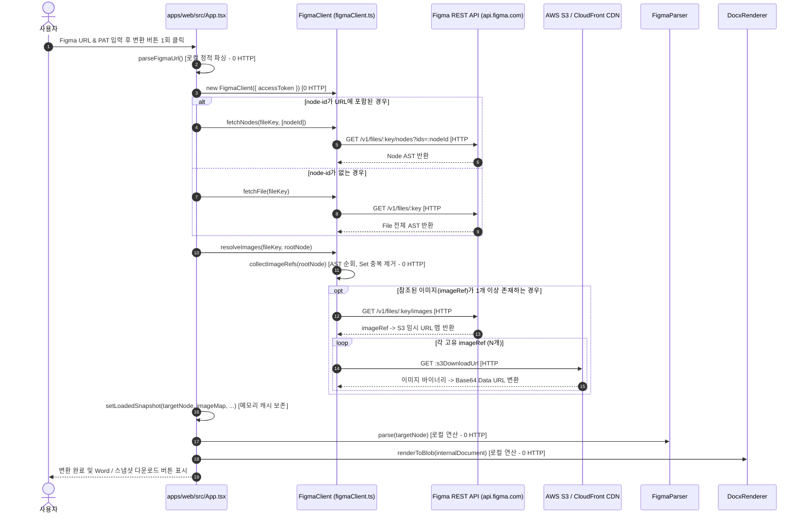

# Figma2Word — Step 8A: 실제 Figma API 테스트 전 사전 점검 보고서

## 1. 개요 및 원칙 준수 확인

신규 Figma 계정과 신규 Personal Access Token(PAT)이 준비되었으며, 기존 테스트 대상 디자인(`Final-Prj`)이 새 Figma 파일로 복사된 상태이다. Figma REST API의 호출 횟수(Rate Limit Quota)를 엄격하게 보존하고 데이터 유실을 방지하기 위해, 실제 API를 호출하기 전에 전체 호출 경로와 안전장치를 코드 수준에서 사전 점검한다.

### 1.1 절대 준수 조건 확인
- **Figma API 호출**: **0건 (일체 호출하지 않음)**
- **신규 PAT 사용**: **0건 (코드나 환경변수, 네트워크에 사용하지 않음)**
- **테스트용 호출/자동 재시도**: **없음**
- **기존 제품 코드 변경**: **없음**
- **Git 커밋 및 Push**: **수행하지 않음**

---

## 2. 실제 변환 호출 경로 및 HTTP 요청 수 정밀 조사

`apps/web/src/App.tsx`, `src/api/figmaClient.ts`, `src/pipeline/index.ts`의 실제 구현 코드를 추적하여, 사용자가 UI에서 변환 버튼을 1회 클릭했을 때 발생하는 네트워크 호출을 정밀 분석하였다.

### 2.1 URL 입력부터 변환 완료까지의 호출 시퀀스



### 2.2 한 번의 변환 클릭 시 발생하는 실제 HTTP 요청 수 집계

| 호출 대상 | 엔드포인트 / 프로토콜 | 요청 횟수 | Rate Limit 적용 여부 |
| :--- | :--- | :---: | :---: |
| **Figma REST API** | `GET /v1/files/:key/nodes` 또는 `/files/:key` | **1회** | **적용 (Tier 제한)** |
| **Figma REST API** | `GET /v1/files/:key/images` | **1회** (이미지 존재 시) | **적용 (Tier 제한)** |
| **외부 이미지 CDN** | `GET https://...s3.../images/...` | **N회** (고유 이미지 수) | 미적용 (S3/CDN 정적 파일) |
| **합계** | **1회 클릭 기준** | **2회 (Figma API) + N회 (S3)** | **Figma API 소진: 단 2건** |

- **고객 디자인(`Final-Prj`) 기준 예상 호출 건수**:
  - `Final-Prj`에는 카드 일러스트/프로필 이미지 2개가 포함되어 있음.
  - Figma REST API 호출: **정확히 2건** (`/nodes` 1건 + `/images` 1건).
  - 외부 S3 이미지 다운로드: **2건**.
  - **총 HTTP 요청: 4건 (Figma API Quota 소진은 단 2건에 불과)**.

### 2.3 중복 요청 및 재시도 위험 분석
- **중복 이미지 요청 가능성**: **0%**
  - `collectImageRefs(rootNode)`가 `Set<string>` 자료구조를 사용하여 동일한 이미지가 수십 번 반복되어도 고유 ID당 1회만 수집함.
  - `FigmaClient.imageCache` (`Map<string, string>`)가 인스턴스 메모리에 캐시하므로 중복 다운로드가 원천 차단됨.
- **실패 시 자동 재시도(Auto-retry)**: **전무 (0회)**
  - `FigmaClient.get()` 및 `App.tsx` 내에 재시도 루프(while, retry queue)가 일체 없음.
  - 요청 실패 시 즉시 `FigmaApiError`를 던지고 중단되므로 불필요한 API 낭비나 '재시도 폭풍(Retry storm)' 위험이 전혀 없음.

---

## 3. 스냅샷 저장 안전성 및 장애 시나리오 검토

현재 UI(`apps/web/src/App.tsx`)가 원본 데이터를 획득한 후 DOCX 생성에 실패하더라도 JSON 스냅샷을 저장할 수 있는지 코드 기반으로 검토하였다.

### 3.1 4대 예외 시나리오 분석

1. **시나리오 1: Figma 노드 수신 성공, 이미지 수신 실패**
   - `resolveImages()` 내부 코드([`figmaClient.ts#L487-L495`](file:///c:/Users/77/Documents/Figma2Word/src/api/figmaClient.ts#L487-L495)):
     - 개별 이미지 다운로드 실패 시 `catch` 블록에서 에러를 삼키고(`console.warn`) 다음 이미지로 진행함.
     - `fetchImageFills` 실패 시에도 에러를 삼키고 빈 맵을 반환함.
     - 따라서 네트워크 단절 등 치명적인 예외가 발생하지 않는 한 `setLoadedSnapshot()` 라인까지 정상 도달함.
     - 단, `resolveImages()` 함수 자체가 네트워크 연결 끊김 등으로 Uncaught Exception을 던지면 `setLoadedSnapshot()`이 호출되지 못할 위험이 존재함.
2. **시나리오 2: 노드 및 이미지 수신 성공, DOCX 렌더링 실패**
   - 코드 위치: [`App.tsx#L157-L163`](file:///c:/Users/77/Documents/Figma2Word/apps/web/src/App.tsx#L157-L163)
   - `setLoadedSnapshot()`은 `FigmaParser.parse()` 및 `DocxRenderer.renderToBlob()` 호출 **이전에** 실행됨!
   - 따라서 레이아웃 파서나 Word 렌더러에서 에러가 발생하여 `catch` 블록으로 이동하더라도, 이미 React 상태에 `loadedSnapshot`이 등록됨.
   - UI 렌더링 코드([`App.tsx#L425-L449`](file:///c:/Users/77/Documents/Figma2Word/apps/web/src/App.tsx#L425-L449))에 의해, 에러 메시지가 화면에 출력되어도 상단에 **`⚡ 메모리 스냅샷 보존 중: [...]` 배너와 `💾 Figma JSON 스냅샷 저장` 버튼이 정상 표시됨.**
   - **결론: DOCX 렌더링 실패 시에도 원본 스냅샷 저장이 100% 가능함.**
3. **시나리오 3: 브라우저 메모리 부족(OOM)**
   - 대형 디자인의 경우 수십 MB의 Base64 문자열이 메모리를 차지할 수 있음.
   - 그러나 현재 타깃 디자인(`Final-Prj`)은 총 노드 약 100~200개, 이미지 2개(수십 KB) 수준으로 브라우저 힙 메모리 부하는 5MB 미만으로 극히 미미함.
4. **시나리오 4: 스냅샷 JSON 다운로드 실패**
   - 브라우저 표준 `Blob` 생성 및 `URL.createObjectURL(blob)`, 가상 `<a>` 태그 클릭 방식으로 구현되어 있어 다운로드 차단 팝업이 뜨지 않는 한 안전하게 다운로드됨.

### 3.2 차후 권장 최소 개선안 (이번 단계에서는 구현하지 않음)
- *개선안*: `fetchNodes` 성공 직후 즉시 1차 `loadedSnapshot`을 세팅하고, 이후 `resolveImages` 결과가 나오는 대로 점진적으로 병합(Progressive update)하는 구조로 변경하면, 이미지 API가 완전히 실패하더라도 Figma 노드 트리 백업을 100% 확보할 수 있음.

---

## 4. 이미지 완전성 검사 체계

스냅샷 파일이 불완전한 상태인데도 '완전한 백업'으로 오인되어 라이브 API를 다시 호출하지 못하는 사태를 방지하기 위해 다음 검사 체계를 확립한다.

### 4.1 이미지 완전성 판정 기준
1. **참조 개수($M$) 계산**: 노드 트리 전체를 순회하여 `fills` 내의 고유 `imageRef` 개수를 추출 ($M$).
2. **확보 개수($K$) 계산**: `snapshot.imageMap`에 포함된 유효한 Base64 Data URL(`data:image/...;base64,...`) 키 개수 ($K$).
3. **완전성 판정**:
   - $K = M$: **100% 완전 백업 (완전 무결)** -> 이후 Figma API 절대 재호출 불필요.
   - $0 < K < M$: **부분 백업** -> 누락된 이미지가 어떤 것인지 식별 필요.
   - $K = 0$ (단 $M > 0$): **이미지 누락 백업** -> 스냅샷 재획득 필요.

### 4.2 오프라인 검사 가능성
- 사용자가 다운로드한 `.json` 파일에 대해 로컬 Node/PowerShell 스크립트를 통해 API 호출 없이 0.1초 만에 완전성 검사를 수행할 수 있음.

---

## 5. Step 8B 실제 테스트 실행 계획 및 사용자 행동 지침

Figma API 호출 횟수를 **단 1회의 변환 클릭**으로 완벽 통제하기 위한 단계별 행동 지침이다.

### 5.1 단계별 실행 절차

```text
[Step 1] 웹 브라우저에서 로컬 웹 UI 접속 (http://localhost:5173/)
   ↓
[Step 2] "Figma 온라인 연동 변환" 탭 선택
   ↓
[Step 3] 신규 Figma 파일 URL 입력 (반드시 특정 프레임의 ?node-id=... 가 포함되었는지 확인)
   ↓
[Step 4] 신규 발급된 Figma PAT 입력
   ↓
[Step 5] [Figma 실시간 가져오기 & DOCX 변환] 버튼 단 1회 클릭!
   │      ※ 로딩 중 연타 금지!
   ↓
[Step 6] 변환 성공 또는 오류 발생 시, 상단에 나타난
         [💾 Figma JSON 스냅샷 저장] 버튼 클릭하여 .json 파일 다운로드!
   ↓
[Step 7] 다운로드된 .json 파일을 프로젝트 작업 폴더(debug/customer/)에 복사
   ↓
[Step 8] Agent가 오프라인 스냅샷 무결성 및 이미지 완전성 검사 수행
   ↓
[Step 9] 검증 완료 후, 브라우저 UI의 [오프라인 JSON 변환] 탭에서 해당 JSON 파일 업로드
   ↓
[Step 10] 오프라인 Portrait DOCX 및 Landscape DOCX 무제한 생성 & Word COM 비교
```

### 5.2 단계별 중단(Abort) 조건
- **Step 5에서 401 Unauthorized 발생 시**: PAT 토큰 문자열 오타 또는 만료. **절대 반복 클릭하지 말고 즉시 중단**.
- **Step 5에서 403 Forbidden 발생 시**: 새 Figma 계정에 해당 파일 접근 권한 없음. 권한 설정 확인 전까지 **즉시 중단**.
- **Step 5에서 404 Not Found 발생 시**: URL의 fileKey 또는 nodeId가 새 복사본과 불일치. URL 재확인 전까지 **즉시 중단**.
- **Step 5에서 429 Rate Limit 발생 시**: 즉시 중단하고 화면에 표시된 대기 시간을 기록한 후 대기.
- **Step 8에서 이미지 완전성이 0%인 경우**: 오프라인 DOCX 변환 단계로 넘어가지 않고 에러 원인 분석.

---

## 6. 결론 및 Step 8B 진행 판정

- **실제 API 요청 예상 건수**: Figma REST API 기준 **단 2건** (`/nodes`, `/images`).
- **데이터 보존 안전성**: DOCX 렌더링에 실패하더라도 인메모리 스냅샷이 보존되어 다운로드 가능함.
- **최종 판정**: **Step 8B 실제 API 테스트 진행 가능 (READY / GO)**

사용자의 신규 Figma URL 및 PAT 입력 준비가 완료되면, 위의 단계별 실행 지침에 따라 단 1회의 안전한 호출을 통해 원본 스냅샷을 영구 확보할 수 있다.

