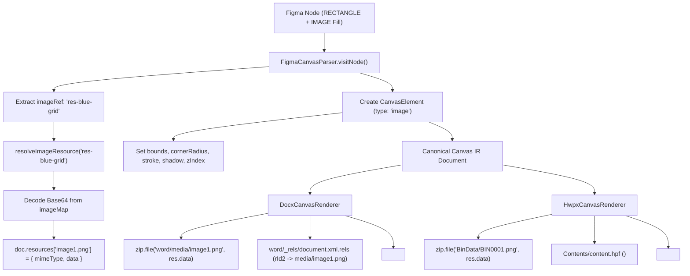

# 06. Figma-to-Canvas IR Pipeline & Image Fill Tracking

## 1. Image Node Conversion Pipeline Trace

Argon requested verification of the transformation pathway when a Figma design node specifies an image fill:
```json
{
  "id": "card-img-avatar",
  "type": "RECTANGLE",
  "fills": [{ "type": "IMAGE", "imageRef": "res-blue-grid", "scaleMode": "FILL" }],
  "cornerRadius": 12,
  "strokes": [{ "type": "SOLID", "color": { "r": 0.75, "g": 0.85, "b": 0.98, "a": 1 } }],
  "strokeWeight": 2,
  "effects": [{ "type": "DROP_SHADOW", "offset": { "x": 0, "y": 8 }, "radius": 16 }]
}
```



---

## 2. Integrity Points Verified

1. **RECTANGLE $\to$ Image Conversion**:
   When a Figma `RECTANGLE` or `FRAME` contains `fills[0].type === "IMAGE"`, `FigmaCanvasParser` correctly classifies the element as `type: "image"` rather than dropping it or treating it as a generic shape.
2. **Resource Normalization**:
   In `figmaCanvasParser.ts` (lines 981–1017), `resolveImageResource` maps the arbitrary Figma `imageRef` string to a clean, extensioned file identifier (e.g. `image1.png`). This guarantees OpenXML `[Content_Types].xml` resolves the MIME type without error.
3. **Property Preservation**:
   `cornerRadius`, `strokeColor`, `strokeWidth`, and `shadow` properties are faithfully transferred to `elem.style`, allowing both DOCX and HWPX renderers to access the complete geometric and visual styling.
4. **Z-Order Consistency**:
   In `CanvasIR`, the image element retains its sequential document order ($z = 8$), and the overlay text retains $z = 9$, ensuring the text renders in front of the image across both formats.
