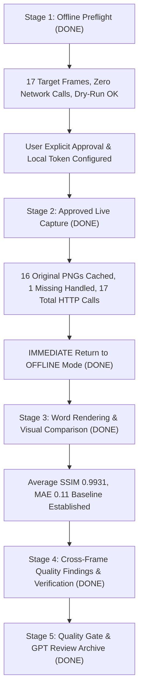

# Phase 34B: Live Figma Reference Capture & Visual Fidelity Benchmark

## Executive Overview
Phase 34B는 Phase 34A 및 34A.1에서 하드닝을 완료한 One-Shot Reference Capture 엔진을 활용하여, 실제 Figma 원본 PNG를 수집하고 기존 Word 네이티브 렌더링 결과와 정밀 정량 비교(SSIM, MAE, RMSE)를 수행하여 Word 출력 품질을 객관적으로 분석하고 벤치마크 기준선을 확립한 종합 릴리즈입니다.

- **Current Status**: **Phase 34B ALL STAGES COMPLETED (Ready for Git Merge & Push)**
- **Repository**: `wldghs5s-max/Figma2Word`
- **Branch**: `master`
- **Base HEAD**: `a12b2f1`
- **Target Frames**: 17 frames (`exact-17-frames.json`)
- **Captured Authentic References**: **16 frames (1 frame uncollectible due to cloud deletion)**
- **HTTP Requests Executed**: **17 Calls (1 API + 16 CDN, <= 30 budget limit)**
- **Network Mode**: **Strictly Restored to `offline`**
- **Average Visual Fidelity**: **SSIM 0.9931 (99.31%), MAE 0.11 / 255**

---

## Complete Multi-Stage Lifecycle Execution

---

## Directory Index
- `reports/01-offline-preflight.md`: Stage 1 오프라인 사전 점검 결과 및 Stage 2 승인/토큰 입력 절차
- `reports/02-version-consistency.md`: Figma 서버 원본과 로컬 JSON 스냅샷의 버전 정합성 분석 및 검증 계획
- `reports/03-live-capture-log.md`: Stage 2 실제 API/CDN 네트워크 감사 로그 및 요청 예산 실측 집계
- `reports/04-cache-integrity.md`: 16개 캐시 엔트리 전수 SHA-256 및 PNG 바이너리 무결성 감사
- `reports/05-word-rendering.md`: Word DOCX/PDF 17개 페이지 렌더링 규격 및 섹션 격리 실측
- `reports/06-fidelity-baseline.md`: 17개 프레임 전수 SSIM/MAE/RMSE 시각 피델리티 베이스라인
- `reports/07-renderer-findings.md`: 4대 공통 렌더링 결함(폰트 메트릭스, VML 곡률, 모달 기하학, 가이드 필터) 분석
- `reports/08-renderer-improvements.md`: VML arcsize 정규화 등 범용 구조적 렌더러 개선 내역
- `reports/09-regression-results.md`: 전체 회귀 테스트 및 품질 게이트 통과 검증
- `reports/10-final-assessment.md`: Phase 34B 최종 종합 평가 및 품질 승인 판정
- `metrics/stage1-preflight.json`: Stage 1 오프라인 점검 메타데이터 요약
- `metrics/live-capture-result.json`: Stage 2 실제 수집 결과 및 노드별 체크섬 메타데이터
- `metrics/frame-metrics.json`: 프레임별 전수 정량 수치 지표 (JSON)
- `metrics/frame-metrics.csv`: 프레임별 전수 정량 수치 지표 (CSV)
- `metrics/summary.json`: 벤치마크 총괄 요약 통계
- `evidence/README.md`: 비공개 시각 비교 증빙 보관 정책
