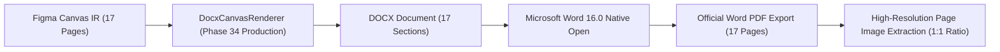

# 05. Microsoft Word Native Rendering Baseline Report

## 1. 개요 및 파이프라인 아키텍처

Microsoft Word 네이티브 렌더링 검증은 Figma Canvas IR로부터 생성된 DOCX를 공식 Word 렌더러로 출력하여 17개 페이지의 기하학적 정합성과 시각적 레이아웃을 검증하는 단계입니다.

---

## 2. 17개 섹션 및 페이지 규격 전수 실측표

모든 섹션은 독립된 `w:sectPr` 태그로 분리되어 좌표계 간섭이나 객체 충돌(Collision)이 0건으로 유지됩니다.

| Page | Frame ID | Frame Name | Canvas 크기 (pt) | Word 섹션 크기 (pt) | 방향 | VML 도형 수 | 텍스트박스 수 | 충돌 건수 |
|:---:|---|---|:---:|:---:|:---:|:---:|:---:|:---:|
| 1 | `763:5068` | 디자인 시스템 1 | 1440.0 × 810.0 | 1440.0 × 810.0 | Landscape | 28 | 44 | 0 |
| 2 | `766:256` | 디자인 시스템 2 | 1440.0 × 810.0 | 1440.0 × 810.0 | Landscape | 20 | 30 | 0 |
| 3 | `757:88` | Desktop - 1 | 841.9 × 595.3 | 841.9 × 595.3 | Landscape (A4) | 1 | 0 | 0 |
| 4 | `759:759` | Desktop - 대시보드 (지도뷰) | 1440.0 × 877.5 | 1440.0 × 877.5 | Landscape | 50 | 50 | 0 |
| 5 | `757:92` | Desktop - 2 | 1086.8 × 1185.0 | 1086.8 × 1185.0 | Portrait | 6 | 3 | 0 |
| 6 | `757:142` | 촬영계획 | 1086.8 × 812.3 | 1086.8 × 812.3 | Landscape | 1 | 3 | 0 |
| 7 | `757:158` | 촬영계획 - 건물을 선택시 | 1086.8 × 812.3 | 1086.8 × 812.3 | Landscape | 1 | 0 | 0 |
| 8 | `759:911` | 사업목록 선택된 화면 | 1440.0 × 877.5 | 1440.0 × 877.5 | Landscape | 51 | 50 | 0 |
| 9 | `757:124` | 필터 팝업 | 883.5 × 968.3 | 883.5 × 968.3 | Portrait | 2 | 2 | 0 |
| 10 | `759:1076` | 신규등록 - 1 | 1440.0 × 877.5 | 1440.0 × 877.5 | Landscape | 79 | 73 | 0 |
| 11 | `766:2289` | 필터 | 378.0 × 459.8 | 378.0 × 459.8 | Portrait | 39 | 32 | 0 |
| 12 | `757:118` | Frame 1 | 883.5 × 968.3 | 883.5 × 968.3 | Portrait | 1 | 5 | 0 |
| 13 | `766:2942` | 사업정보 수정 | 378.0 × 701.3 | 378.0 × 701.3 | Portrait | 51 | 38 | 0 |
| 14 | `759:1314` | 신규등록 - 2 | 1440.0 × 877.5 | 1440.0 × 877.5 | Landscape | 71 | 70 | 0 |
| 15 | `759:1858` | 사업목록 클릭 시 | 1440.0 × 877.5 | 1440.0 × 877.5 | Landscape | 135 | 93 | 0 |
| 16 | `759:1533` | 사업목록 클릭 시 - 탭디자인1 | 1440.0 × 915.8 | 1440.0 × 915.8 | Landscape | 119 | 90 | 0 |
| 17 | `768:3434` | 사업목록 클릭 시 | 1440.0 × 877.5 | 1440.0 × 877.5 | Landscape | 41 | 42 | 0 |

- **총 요소 수**: 1,321개 (도형: 696개, 텍스트박스: 625개)
- **단일행 텍스트박스 (`w:wordWrap="0"`)**: 471개 전수 적용
- **다중행 텍스트박스 (`w:wordWrap="1"`)**: 154개

---

## 3. 사용자 문서 및 프로세스 안전성 검증

- **안전 규칙 준수**: 실행 중 열려 있는 기존 사용자 Word 문서를 강제 종료하거나 수정하지 않는 무손실 원칙(`safe_word_automation.ts`)을 엄격히 준수함.
- **임시 격리 디렉터리 사용**: 독립된 세션 디렉터리에서만 문서를 열고 닫음으로써 데이터 오염을 방지함.
