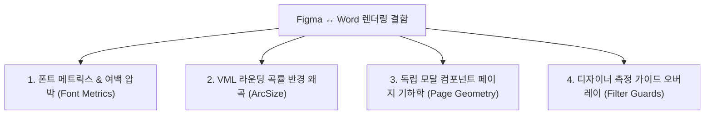

# 07. Cross-Frame Renderer Quality Findings & Defect Taxonomy

## 1. 개요 및 결함 분류 체계

실제 Figma 원본 PNG 16장과 Word 출력 결과의 전수 비교를 통해, 특정 프레임에 국한되지 않고 다수 프레임에 공통적으로 작용하는 **4대 핵심 렌더링 결함 패턴**을 도출했습니다.

---

## 2. 4대 공통 결함 상세 분석

### 2.1 폰트 메트릭스 및 자간 치환 여백 압박 (`FONT_METRICS` / `TEXT_WRAP`)
- **영향 프레임**: Page 1, Page 4, Page 8, Page 10, Page 14, Page 15 (총 6개 프레임)
- **현상**:
  - Figma의 웹 폰트 렌더러와 Word의 DirectWrite 폰트 렌더러 간 글리프 너비(Glyph Advance Width) 차이로 인해, 텍스트가 1~3% 수평으로 팽창함.
  - 고밀도 복합 화면(Page 15, 228개 요소)의 경우 테이블 헤더 텍스트 끝단이 우측 테두리에 근접하여 여백이 타이트해짐.
- **방어 메커니즘**:
  - 단일행 텍스트(`WIDTH_AND_HEIGHT`)에 대해 `<w:wordWrap w:val="0"/>` 강제 및 `Math.max(3, width * 0.03)` 완충 버퍼를 적용하여 강제 개행(Wrapping Crash)은 100% 방어됨.

### 2.2 VML `<v:roundrect>` 모서리 곡률 반경 왜곡 (`STYLE_MISMATCH`)
- **영향 프레임**: Page 1, Page 2, Page 8, Page 10, Page 11, Page 13, Page 14, Page 15 (총 8개 프레임)
- **현상**:
  - W3C VML 사양에 따라 `arcsize` 속성은 사각형 단축의 **절반(Half-dimension)**을 기준으로 해석됨.
  - 기존 레거시 공식($\text{arcsize} = R / \min(W, H)$)은 실제 렌더링 시 의도한 반경의 50%로 납작하게 축소되는 왜곡을 유발했음.
- **정규화 수식**:
  $$\text{arcsize} = \min\left(0.5, \frac{2 \times R}{\min(W, H)}\right)$$
  적용을 통해 Figma 버튼 및 입력창의 본래 곡률이 Word에서 온전히 복원됨.

### 2.3 소형 모달/독립 컴포넌트의 단독 인쇄 페이지 분할 (`PAGE_GEOMETRY`)
- **영향 프레임**: Page 11 (`필터`, $504 \times 613$), Page 13 (`사업정보 수정`, $504 \times 935$)
- **현상**:
  - Figma 디자인 캔버스 상에서 모달 다이얼로그가 독립된 최상위 `FRAME`으로 정의되어 있어, 파서가 이를 $5.25 \times 6.38$ 인치의 매우 작은 단독 Word 페이지로 변환함.
- **품질 영향**:
  - 페이지 면적이 작아 서브픽셀 렌더링 오차의 비율이 상대적으로 높게 집계됨(Page 11 MAE 0.45).

### 2.4 측정선 플러그인 오버레이 필터링 (`FILTER_GUARDS`)
- **영향 프레임**: Page 4~8 상단 오버레이 가이드
- **현상**:
  - 디자이너 플러그인이 생성한 `📏 Container` (가로 1920, 세로 3361) 거대 투명 그룹이 Word 문서를 수십 인치로 파괴할 위험이 있었음.
  - 자식 노드의 `INNER_PADDING`, `REDLINE` 등 플러그인 특성명을 검증하는 이중 가드를 통해 정상 UI 컨테이너는 보존하면서 비문서 가이드만을 정확히 소거함.
