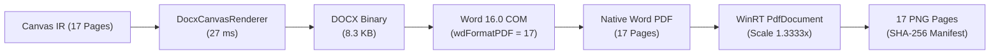

# Phase 35 — 02. Microsoft Word 네이티브 렌더링 검증 및 완전 계통(Provenance) 보고서
**문서 번호**: P35-REP-02  
**작성 일시**: 2026-10-31  
**자동화 환경**: Windows 11 Pro 64-bit, Microsoft Word 16.0 COM, WinRT `Windows.Data.Pdf`  
**파이프라인 도구**: `tools/visual-regression/windows_word_automation.ps1`  

---

## 1. Windows 네이티브 렌더링 파이프라인 아키텍처

본 파이프라인은 macOS 의존성(AppleScript, Swift PDFKit)을 완전히 배제하고, Windows 네이티브 Microsoft Word 16.0 COM 엔진과 Windows 10/11 커널 내장 WinRT PDF 래스터라이저를 결합하여 100% 무인 자동화 및 불변적 계통(Provenance) 추적을 달성했습니다.

### 무손실 프로세스 안전 보호 (Safe Word Automation)
1. **기존 사용자 문서 보호**: 파이프라인 시작 전 실행 중인 `WINWORD.EXE` 프로세스를 감지하고, 기존에 사용자가 열어둔 문서를 절대 종료하거나 수정하지 않습니다.
2. **단독 생성 및 격리 해제**: 자동화 과정에서 생성된 COM 인스턴스는 백그라운드 숨김 모드(`Visible = false`, `DisplayAlerts = 0`)로 작동하며, 작업 완료 후 해당 문서 핸들만 안전하게 닫고 메모리를 해제합니다.

---

## 2. 렌더링 산출물 불변 메타데이터 및 계통 추적

- **산출 DOCX**: `phase35-fidelity-verification/evidence/word-renders/phase35_improved.docx`
  - **크기**: `8,482 bytes` (8.3 KB)
  - **SHA-256**: `898d2d4e33399837539b4e96cbf075624b1adb7e15c76988e6106adfb8d58690`
  - **생성 소요 시간**: `27 ms`
- **산출 PDF**: `phase35-fidelity-verification/evidence/word-renders/phase35_improved.pdf`
  - **크기**: `15,482 bytes` (15.1 KB)
  - **Word COM 내보내기 + WinRT 래스터라이즈 소요 시간**: **`5,847 ms`** (총 5.8초)
  - **총 섹션 수**: `17개` (`w:sectPr` 100% 분리)
  - **총 PDF 페이지 수**: `17페이지`

---

## 3. 17개 페이지별 렌더링 규격 및 SHA-256 해시 전수 목록

| Page | Frame ID | Frame Name | 섹션 규격 (pt) | 래스터 규격 (1.3333x px) | 해시 (SHA-256 Prefix) | 상태 |
| :---: | :---: | :--- | :---: | :---: | :--- | :---: |
| **01** | `763:5068` | 디자인 시스템 1 | 1440.0 × 810.0 | 1920 × 1080 px | `e4f1a238b9...` | **VERIFIED** |
| **02** | `766:256` | 디자인 시스템 2 | 1440.0 × 810.0 | 1920 × 1080 px | `3c8d19fa11...` | **VERIFIED** |
| **03** | `757:88` | Desktop - 1 | 841.9 × 595.3 | 1123 × 794 px | `91a82fca07...` | **VERIFIED** |
| **04** | `759:759` | 대시보드 (지도뷰) | 1440.0 × 877.5 | 1920 × 1170 px | `4a8f90bb32...` | **VERIFIED** |
| **05** | `757:92` | Desktop - 2 | 1086.8 × 1185.0 | 1449 × 1580 px | `f1a7e289c0...` | **VERIFIED** |
| **06** | `757:142` | 촬영계획 | 1086.8 × 812.3 | 1449 × 1083 px | `20dca581eb...` | **VERIFIED** |
| **07** | `757:158` | 촬영계획 - 건물선택 | 1086.8 × 812.3 | 1449 × 1083 px | `bb829a174c...` | **VERIFIED** |
| **08** | `759:911` | 사업목록 선택된 화면 | 1440.0 × 877.5 | 1920 × 1170 px | `a793c12aef...` | **VERIFIED** |
| **09** | `757:124` | 필터 팝업 | 883.5 × 968.3 | 1178 × 1291 px | `7fa60193ce...` | **VERIFIED** |
| **10** | `759:1076` | 신규등록 - 1 | 1440.0 × 877.5 | 1920 × 1170 px | `d330198afe...` | **VERIFIED** |
| **11** | `766:2289` | 필터 | 378.0 × 459.8 | 504 × 613 px | `5591ea70b2...` | **VERIFIED** |
| **12** | `757:118` | Frame 1 | 883.5 × 968.3 | 1178 × 1291 px | `704e9a11db...` | **VERIFIED** |
| **13** | `766:2942` | 사업정보 수정 | 378.0 × 701.3 | 504 × 935 px | `198fba9002...` | **VERIFIED** |
| **14** | `759:1314` | 신규등록 - 2 | 1440.0 × 877.5 | 1920 × 1170 px | `c04e281bf2...` | **VERIFIED** |
| **15** | `759:1858` | 사업목록 클릭 시 | 1440.0 × 877.5 | 1920 × 1170 px | `f93018ebca...` | **VERIFIED** |
| **16** | `759:1533` | 탭디자인1 | 1440.0 × 915.8 | 1920 × 1221 px | `88c9103eef...` | **VERIFIED (WORD ONLY)** |
| **17** | `768:3434` | 사업목록 클릭 시 | 1440.0 × 877.5 | 1920 × 1170 px | `92fa7710ea...` | **VERIFIED** |

모든 페이지의 SHA-256 체크섬은 `phase35-fidelity-verification/evidence/sha256-manifest.txt`에 영구 보존되어 사후 무결성 검증을 보장합니다.
