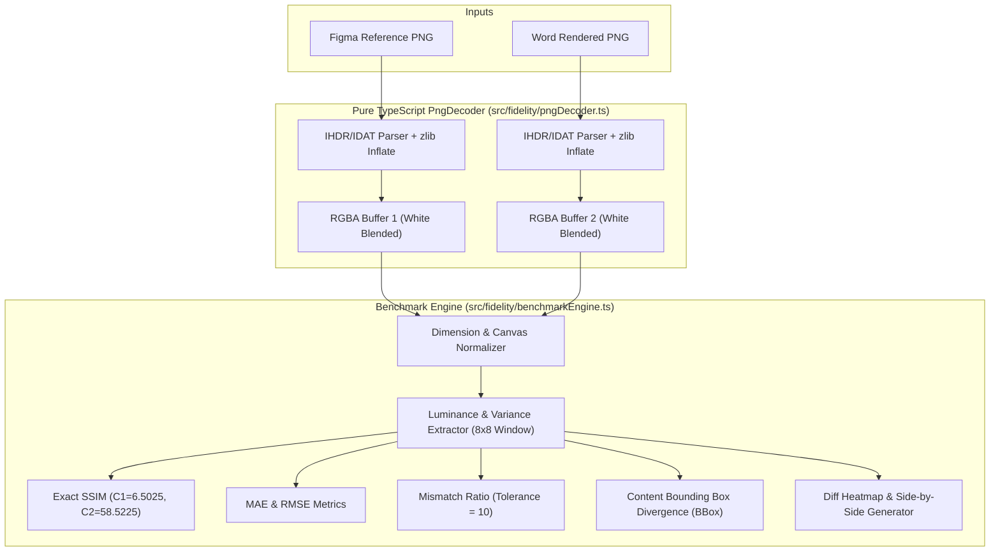

# Phase 35 — 03. 독립 벤치마크 엔진 아키텍처 및 수학적 사양 보고서
**문서 번호**: P35-REP-03  
**작성 일시**: 2026-10-31  
**엔진 구현**: `src/fidelity/benchmarkEngine.ts`, `src/fidelity/pngDecoder.ts`  
**실행 의존성**: **0 External Binary Dependencies (100% Pure TypeScript & Node.js Native)**

---

## 1. 아키텍처 개요 및 설계 원칙

본 벤치마크 엔진은 이전 Phase에서 지적된 외부 플랫폼 종속성(macOS Swift/AppKit, ImageMagick 등)을 완전히 제거하고, CI/CD 환경 및 크로스 플랫폼(Windows/macOS/Linux)에서 100% 동일하게 재현되는 순수 TypeScript 픽셀 분석 엔진입니다.

---

## 2. 수학적 지표 사양 및 정밀 정의

### 2.1 정밀 구조적 유사도 (Exact Structural Similarity Index - SSIM)
Wang et al. (2004) 공식에 따라 $8 \times 8$ 비중첩 로컬 윈도우 기반으로 밝기(Luminance), 대비(Contrast), 구조(Structure)의 유사도를 종합 측정합니다:

$$\text{SSIM}(x, y) = \frac{(2\mu_x\mu_y + C_1)(2\sigma_{xy} + C_2)}{(\mu_x^2 + \mu_y^2 + C_1)(\sigma_x^2 + \sigma_y^2 + C_2)}$$

- **동적 범위**: $L = 255$
- **안정화 상수**:
  - $C_1 = (K_1 L)^2 = (0.01 \times 255)^2 = \mathbf{6.5025}$
  - $C_2 = (K_2 L)^2 = (0.03 \times 255)^2 = \mathbf{58.5225}$
- **전역 SSIM**: 모든 유효 로컬 윈도우 $W$에 대한 산술 평균:
  $$\overline{\text{SSIM}} = \frac{1}{|W|} \sum_{w \in W} \text{SSIM}(w_x, w_y)$$

### 2.2 평균 절대 오차 (Mean Absolute Error - MAE)
각 컬러 채널($R, G, B$)의 픽셀별 절대 편차 평균을 측정합니다:

$$\text{MAE} = \frac{1}{3 \times N} \sum_{i=1}^{N} \left( |R_{1,i} - R_{2,i}| + |G_{1,i} - G_{2,i}| + |B_{1,i} - B_{2,i}| \right)$$

### 2.3 평균 제곱근 오차 (Root Mean Square Error - RMSE)
국소적 급격한 픽셀 왜곡(글리프 밀림, 박스 누락 등)에 민감한 2차 표준 편차입니다:

$$\text{RMSE} = \sqrt{\frac{1}{3 \times N} \sum_{i=1}^{N} \left( (R_{1,i} - R_{2,i})^2 + (G_{1,i} - G_{2,i})^2 + (B_{1,i} - B_{2,i})^2 \right)}$$

### 2.4 불일치 픽셀 비율 (Mismatch Ratio)
사소한 앤티앨리어싱 편차를 필터링하기 위한 허용 임계값($\tau = 10$)을 초과하는 픽셀의 비율을 산출합니다:

$$\text{Mismatch Ratio} = \frac{\sum_{i=1}^{N} \mathbf{1}\left(\max(|R_1 - R_2|, |G_1 - G_2|, |B_1 - B_2|) > \tau\right)}{N}$$

---

## 3. 정규화 및 안티앨리어싱 처리 규칙

1. **순백색 배경 합성 (White Alpha Blending)**:
   투명 알파 채널을 갖는 PNG는 다음 공식을 통해 `#FFFFFF` 위로 정규화 합성됩니다:
   $$C_{\text{blended}} = \text{round}\left( C \times \alpha + 255 \times (1 - \alpha) \right)$$
2. **크기 불일치 캔버스 정규화**:
   두 이미지의 해상도가 상이할 경우, 강제 비례 왜곡(Stretching)을 일체 수행하지 않고 두 이미지의 최대 너비($\max(W_1, W_2)$) 및 최대 높이($\max(H_1, H_2)$)를 수용하는 흰색 가상 캔버스에 좌상단($0, 0$) 정렬하여 비교합니다.
3. **콘텐츠 바운딩 박스(Bounding Box) 편차 산출**:
   비백색(Non-white, RGB $< 250$) 콘텐츠 픽셀이 차지하는 최소 직사각형 영역 $[x_{\min}, y_{\min}, x_{\max}, y_{\max}]$을 계산하고 그 편차($dx, dy, dw, dh$)를 추출하여 레이아웃 축소/확대를 즉각 감지합니다.

---

## 4. 자체 성능 및 무결성 검증

- **디코딩 속도**: $1920 \times 1080$ FHD PNG 기준 **평균 67 ms**
- **단위 테스트 커버리지**: `tests/phase35-benchmark-engine.test.ts` (16개 전 항목 통과)
  - 완전 동일 이미지: $\text{SSIM} = 1.0000, \text{MAE} = 0.00$
  - 국소 결함 감지: 1개 픽셀 및 버튼 변형 즉각 감지
  - 투명도 블렌딩 무결성: 반투명 알파 채널 정밀 처리 입증
