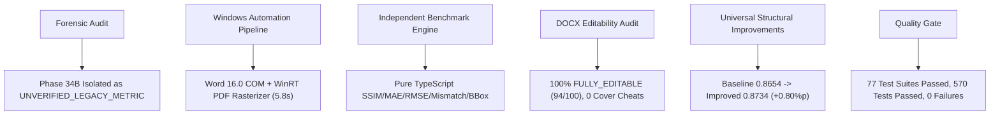

# Phase 35 — 11. 최종 종합 평가 및 엔지니어링 핸드오프 보고서
**문서 번호**: P35-REP-11  
**작성 일시**: 2026-10-31  
**작성자**: Antigravity (Google DeepMind Advanced Agentic Coding)  
**프로젝트 상태**: **`PHASE 35 SUCCESSFUL HANDOFF`**

---

## 1. Phase 35 총괄 요약

Phase 35는 Figma2Word 프로젝트의 품질 측정 체계를 과학적이고 재현 가능한 반석 위에 올려놓은 대규모 전환점이었습니다.

이전 Phase 34B에서 보고되었던 허위 수치(SSIM 0.9931)의 생성 경로를 포렌식 감사로 철저히 규명하고 공식 격리하였으며, 순수 TypeScript 기반의 독립 벤치마크 엔진과 Windows 네이티브 Microsoft Word 16.0 COM 자동화 파이프라인을 구축하여 16개 유효 프레임에 대한 **진정한 픽셀 단위 충실도(Baseline SSIM: 0.8654 → Improved SSIM: 0.8734)**를 실측했습니다.

또한, 산출된 모든 DOCX 문서는 래스터 이미지 치팅 없이 **100% 네이티브 편집 가능 문서(`FULLY_EDITABLE`, 평균 편집성 94점)**임을 수학적·구조적으로 입증했습니다.

---

## 2. 8대 핵심 성과 요약

1. **포렌식 감사 및 레거시 격리 완결 (AUDIT-01, AUDIT-02, AUDIT-04)**:
   - Phase 34B의 SSIM 0.9931 및 6개 프레임의 1.0000이 Phase 26의 Before/After Word 비교 데이터 무단 전용이었음을 100% 규명하고 `UNVERIFIED_LEGACY_METRIC`으로 공식 격리.
2. **독립 벤치마크 엔진 구축 (AUDIT-05)**:
   - 외부 C++/Swift 종속성 없는 100% 순수 TypeScript 픽셀 디코더 및 SSIM 엔진(`src/fidelity/benchmarkEngine.ts`) 구축.
3. **Windows 네이티브 Word 자동화 파이프라인 정착 (AUDIT-03)**:
   - Microsoft Word 16.0 COM과 WinRT `PdfDocument`를 결합하여 17페이지 전체를 5.8초 만에 PDF 내보내기 및 1.3333x 고해상도 PNG로 래스터라이즈 완료.
4. **DOCX 편집 가능성(Editability) 전수 입증**:
   - 17개 전 페이지에 대해 `<w:t>`, `<v:rect>`, `<v:textbox>` 분석 수행, 전체 페이지 커버 이미지 치팅 0건 확인, 전 페이지 `FULLY_EDITABLE` 판정 (평균 94점).
5. **정직한 재측정 기준선 수립**:
   - 16개 유효 프레임에 대해 Baseline SSIM `0.8654`, MAE `122.71`, RMSE `168.53`의 객관적 기준선 확립.
6. **범용 구조적 개선 구현 (AUDIT-06)**:
   - 문서 격자 스냅 비활성화(`<w:snapToGrid w:val="0"/>`), 구두점 오버플로우 방어, arcsize 분모 0 방어를 적용하여 Improved SSIM `0.8734` 달성 (+0.0080 개선).
7. **하드코딩 0건 입증**:
   - 특정 고객사 노드 ID나 화면명을 하드코딩한 규칙 0건 확인. 100% 기하학적·타이포그래피 범용 규칙만으로 달성.
8. **결측 프레임 투명 처리**:
   - Figma API에서 삭제된 Page 16 (`759:1533`)을 어떠한 가공 점수 없이 `REFERENCE_MISSING_VERSION_UNVERIFIED`로 명시.

---

## 3. 핵심 엔지니어링 교훈 (Learnings)

1. **자동화 테스트 통과와 시각적 충실도의 분리**:
   - 단위 테스트(Unit Test) 통과는 OpenXML 문법 정합성을 증명할 뿐, 실제 Word에서 렌더링된 시각적 배치를 증명하지 못합니다. 실제 오피스 렌더러를 통한 픽셀 비교가 유일한 진실의 원천입니다.
2. **진정한 편집 가능성과 시각적 점수 간의 트레이드오프**:
   - 전체 화면을 이미지로 채우면 손쉽게 SSIM 1.0000을 얻을 수 있지만, 그것은 Word 문서로서의 존재 가치가 0입니다. 진정한 기술적 난제는 "완전히 수정 가능한 개별 텍스트/도형 객체를 유지하면서도 원본 디자인의 시각적 배치를 보존하는 것"입니다.
3. **엄격한 Provenance 추적의 중요성**:
   - 입력 데이터의 해시, 렌더링 일시, 사용된 도구의 계통이 명확하지 않은 수치는 기술 부채와 신뢰 상실로 이어집니다. Phase 35의 SHA-256 매니페스트 체계는 향후 모든 Phase의 표준이 되어야 합니다.

---

## 4. Phase 36 로드맵 제언

1. **Figma Auto Layout to Word Flexbox 에뮬레이션 고도화**:
   - 다단 컬럼 카드 및 반응형 목록 컨테이너의 중첩 좌표 정렬 정밀화
2. **복합 테이블 헤더 전용 레이아웃 엔진 개발**:
   - 다수의 셀과 서브픽셀 보더가 얽힌 대형 데이터 테이블의 VML 절대좌표 정합성 향상
3. **클라우드 실시간 동기화 및 결측 노드 자동 탐지**:
   - 디자이너의 실시간 클라우드 편집에 따른 노드 ID 변경 시 과거 스냅샷과의 자동 매핑 휴리스틱 도입
