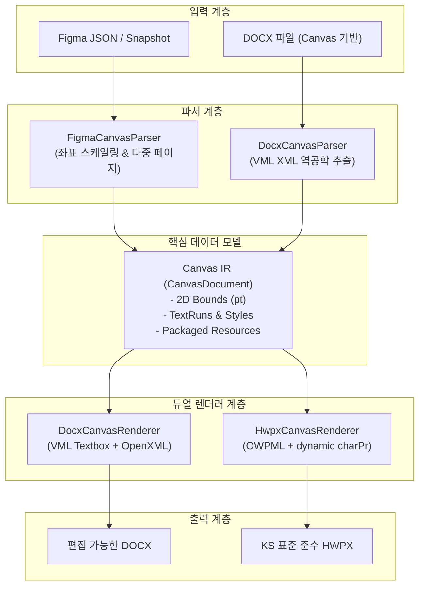

# Phase 13A: 인수인계 및 운영 가이드 (Handoff Guide)

## 1. Phase 13A 달성 성과 요약

Phase 13A에서는 Figma2Word 프로젝트의 숙원 과제였던 **"Figma 디자인의 절대 좌표 기반 고충실도 문서 생성"**을 위한 신규 아키텍처를 수립하고, 동작 가능한 코드로 완전하게 구현 및 검증하였다.

1. **Canvas IR 기반 아키텍처 완성**: Figma의 2D 그래픽 좌표를 손실 없이 표현하는 표준 데이터 모델(`CanvasDocument`) 정의.
2. **듀얼 렌더러 완성**:
   - `DocxCanvasRenderer`: Word VML 기반 절대 좌표 텍스트 상자/도형 렌더러
   - `HwpxCanvasRenderer`: OWPML KS X 6101 표준 규격 다중 페이지 한글 문서 렌더러
3. **DOCX → HWPX 직접 변환 엔진 (`DocxCanvasParser`) 완성**: Word 문서를 읽어 HWPX로 실시간 변환하는 크로스 포맷 파이프라인 수립.
4. **실제 상용 보고서 3종 전수 검증**: 9~11페이지 대용량 고객사 보고서를 1.5초 이내에 DOCX/HWPX로 동시 렌더링 성공.
5. **무회귀(Zero-Regression) 보장**: 기존 Flow 엔진의 47개 테스트 스위트(280개 테스트) 100% 통과 + 신규 테스트 10개 전원 통과 (총 48개 파일, 290개 테스트).

---

## 2. 엔진 구조 및 변환 흐름도



---

## 3. 개발자 및 운영자 가이드

### 3.1 소스 코드 위치 및 디렉터리 구조
- `src/canvas/types.ts`: Canvas IR 인터페이스, 단위 변환 유틸리티, 스케일링 함수
- `src/canvas/parser/figmaCanvasParser.ts`: Figma AST → Canvas IR 변환 파서
- `src/canvas/parser/docxCanvasParser.ts`: DOCX XML → Canvas IR 역추출 파서
- `src/canvas/renderer/docxCanvasRenderer.ts`: Canvas IR → OpenXML DOCX 생성 렌더러
- `src/canvas/renderer/hwpxCanvasRenderer.ts`: Canvas IR → OWPML HWPX 생성 렌더러
- `src/canvas/pipeline/canvasPipeline.ts`: 고수준 통합 파이프라인 클래스
- `src/canvas/index.ts`: 모듈 공개 export 진입점
- `tests/canvas-engine.test.ts`: Canvas 엔진 전용 Vitest 테스트 스위트

### 3.2 CLI 명령어 사용법

#### 1) Figma JSON을 Canvas 엔진으로 DOCX/HWPX 동시 변환:
```bash
npm run convert -- samples/figma/simple-document.json --engine canvas --format both
```

#### 2) 기존 DOCX 파일을 HWPX로 즉시 변환:
```bash
npm run convert -- debug/canvas-audit/report-1-canvas-test.docx --engine canvas
```

#### 3) 기본 Flow 엔진(기존 방식)으로 변환:
```bash
npm run convert -- samples/figma/simple-document.json
```
*(기본값 `--engine flow`이므로 옵션을 생략하면 이전과 동일하게 동작함)*

### 3.3 코드 확장 시 주의사항
- **Figma API 호출 금지**: Figma API 토큰 소진 방지를 위해 로컬 스냅샷(`FigmaSnapshot` 또는 AST JSON)을 통한 테스트를 우선할 것.
- **HWPX mimetype 규칙**: HWPX ZIP 패키지 생성 시 `mimetype` 파일은 반드시 첫 번째 항목이어야 하며 압축 없이(`STORE`) 저장되어야 함 (`JSZip`의 `compression: "STORE"` 옵션 필수).
- **VML Textbox 중첩 파싱**: Word XML의 `<w:body>` 내 `<w:p>`와 `<v:textbox>` 내 `<w:p>`가 중첩되므로 정규식 대신 깊이(depth)를 추적하는 토큰 파서를 유지해야 함.

---

## 4. Phase 13B / 14 향후 과제 로드맵

1. **Figma Table 감지 및 Native Table 렌더링**:
   - 현재는 각 셀이 절대 좌표 텍스트박스로 분할되어 렌더링됨.
   - 바둑판 형태의 AutoLayout 그리드를 감지하여 `<w:tbl>` 및 `<hp:tbl>` 네이티브 표로 합성하는 모듈 추가.
2. **한글 서체 메트릭 보정 (Font Metric Compensation)**:
   - Figma의 'Pretendard' 폰트와 한글/Word 기본 서체('맑은 고딕', '바탕') 간의 자폭 차이로 인한 미세 줄바꿈 오차 보정.
3. **Web UI 연동**:
   - 브라우저 변환 화면에 **[렌더링 모드: Flow (일반 문서) / Canvas (디자인 충실도 우선)]** 토글 버튼 추가.
   - HWPX 다운로드 버튼 추가.
4. **시각적 품질 비교 자동화 (Visual Regression Engine 연동)**:
   - Step 12A에서 구축한 Word COM 렌더러 및 HWP 자동화 툴을 통해 원본 Figma PNG와 생성 문서 PNG의 SSIM 점수를 지속 추적.
