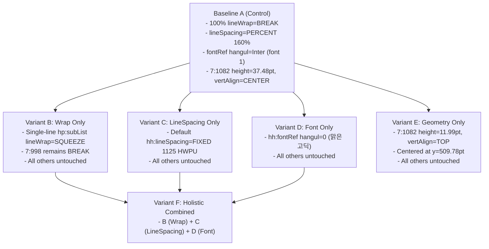

# 09. HWPX Overlap Root-Cause Isolation Experiment Design (MRE A~F)

## 1. 실험 목적 및 기본 원칙

본 실험의 목적은 한컴오피스 2024 뷰어에서 지속되는 **HWPX 텍스트 겹침 및 객체 충돌 결함의 근본 원인을 과학적으로 단일 변수 분리(Single Variable Isolation) 기법을 통해 규명**하는 것입니다.

### 1.1 기본 준수 원칙
1. **프로덕션 코드 동결 (Production Code Frozen)**:
   - `src/canvas/**` 내 렌더러, 파서, 타입 등 어떠한 프로덕션 코드도 수정하지 않습니다.
   - 모든 변종은 기준 HWPX 바이너리 직렬화 후 XML 변이 스크립트(`scripts/generate_mre_experiments.ts`)를 통해서만 생성됩니다.
2. **엄격한 구조적 동일성 (Strict Structural Invariance)**:
   - 모든 변종(A~F)은 동일한 2페이지 A4 세로(595.28 x 841.89 pt, `WIDELY`) 규격을 유지합니다.
   - 모든 변종은 동일한 21개 객체, 11개 텍스트박스, 동일한 텍스트 내용을 유지합니다.
   - 각 변종은 지정된 실험 변수 1개 외의 어떠한 XML 속성도 변경하지 않습니다.
3. **가설의 독립적 검증**:
   - 자동 테스트 통과를 해결의 증거로 삼지 않으며, 한컴오피스 2024 뷰어에서의 실제 시각적 렌더링 결과만을 판정 기준으로 삼습니다.

---

## 2. 실험 대상 진단 요소 배치 (2-Page Architecture)

Stage 7 실제 스냅샷(`Report1-Live-Snapshot.json`)에서 가장 심각한 충돌이 발생한 요소를 2개 페이지로 격리하여 구성했습니다.

### Page 1: 단일행 지표 세트 및 다중행 요약 본문
- **단일행 충돌 세트 1**:
  - `7:980` ("균열밀도 (CDI)", 8.25pt, y=457.30, h=9.75, w=53.98 pt)
  - `7:981` ("0.031%", 15.0pt, y=473.05, h=17.99, w=55.48 pt)
  - `7:982` ("안전 기준선 이하", 8.25pt, y=497.04, h=9.75, w=58.48 pt)
  - *핵심 관찰점: `7:980` 하단(467.05)과 `7:981` 상단(473.05) 사이의 간격은 단 6.0pt입니다.*
- **단일행 충돌 세트 2**:
  - `7:988` ("정제 검출 균열", 8.25pt, y=457.30, h=9.75, w=50.23 pt)
  - `7:989` ("1,248 개", 15.0pt, y=473.05, h=17.99, w=58.48 pt)
  - `7:990` ("노이즈 정제 완료", 8.25pt, y=497.04, h=9.75, w=58.48 pt)
- **다중행 본문 및 직하단 객체 세트**:
  - `7:995` (배경 카드, y=542.77, h=59.97, w=514.31 pt)
  - `7:998` ("전반적인 외벽 균열 상태는 안전 범주에 있습니다...", 10.5pt, y=542.77, h=59.97, w=426.59 pt, `isMultiLineBox=true`)
  - `7:999` (직하단 간격 카드, y=626.73, h=139.44, w=514.31 pt)

### Page 2: 중앙 정렬 배너 기하학
- `7:1080` (배경 카드, y=497.04, h=37.48, w=514.31 pt)
- `7:1081` (아이콘, y=509.03, h=13.49, w=13.50 pt)
- `7:1082` ("품질 가공 단계: AI 원검출 → 노이즈 제거 → 중첩 보정 → 정제 1,248개 기준", 9.75pt, y=497.04, h=37.48, w=305.14 pt, `contentHeightPt=11.99`)

---

## 3. 실험 변종 (Variant A ~ F) 상세 설계

### 3.1 Variant A: 기준 대조군 (`mre-A-baseline.hwpx`)
- **목적**: 현재 엔진의 오류 현상 기준선 확보.
- **주요 속성**:
  - `Contents/section0.xml`: 모든 텍스트박스에 `<hp:subList lineWrap="BREAK">`.
  - `Contents/header.xml`: 기본 문단 스타일에 `<hh:lineSpacing type="PERCENT" value="160" unit="PERCENT"/>`.
  - `Contents/header.xml`: 모든 `charPr`에 `<hh:fontRef hangul="1" latin="1" .../>` (font 1 = Inter).
  - `7:1082`: 박스 높이 37.48pt, `vertAlign="CENTER"`.
- **예상 뷰어 현상**:
  - `7:980` 라벨이 2행으로 강제 개행되면서 `7:981` ("0.031%")의 상단과 충돌 및 겹침.
  - `7:1082` 배너 텍스트가 카드 하단으로 밀려 시각적 정렬 파괴.

### 3.2 Variant B: 조건부 줄바꿈 변이 (`mre-B-wrap-only.hwpx`)
- **격리 변수**: `Contents/section0.xml` 내 `hp:subList`의 `lineWrap` 속성.
- **변이 내용**:
  - 단일행 텍스트박스 10개: `lineWrap="BREAK"` → `lineWrap="SQUEEZE"`.
  - 다중행 요약 본문(`7:998`): `lineWrap="BREAK"` 유지.
  - `Contents/header.xml`은 A와 100% 동일(바이트 단위 일치).
- **검증 가설**:
  - 단일행 라벨(`7:980`, `7:988` 등)에서 발생하는 폭 부족 강제 개행이 `SQUEEZE`(자간 미세 압축)를 통해 억제되어, 직하단 수치(`7:981`, `7:989`)와의 6pt 간격이 온전히 유지될 것이다.

### 3.3 Variant C: 고정 행간 변이 (`mre-C-lineheight-only.hwpx`)
- **격리 변수**: `Contents/header.xml` 내 기본 문단 스타일의 `hh:lineSpacing`.
- **변이 내용**:
  - `paraPr` id 0, 1, 2, 3: `<hh:lineSpacing type="PERCENT" value="160" unit="PERCENT"/>` → `<hh:lineSpacing type="FIXED" value="1125" unit="HWPUNIT"/>`.
  - `Contents/section0.xml`은 A와 100% 동일(바이트 단위 일치).
- **검증 가설**:
  - 160% 과다 행간이 11.25pt(고정)로 정상화되어, 줄바꿈이 발생하더라도 행간 높이 팽창이 줄어들어 아래 객체 침범 깊이가 현저히 감소할 것이다.

### 3.4 Variant D: 한글 폰트 매핑 변이 (`mre-D-font-only.hwpx`)
- **격리 변수**: `Contents/header.xml` 내 `hh:fontRef`의 `hangul` 및 `hanja` 참조 ID.
- **변이 내용**:
  - 8개 `charPr`: `hangul="1"`(Inter) → `hangul="0"`(맑은 고딕).
  - `Contents/section0.xml`은 A와 100% 동일(바이트 단위 일치).
- **검증 가설**:
  - DOCX와 동일하게 한글 글리프를 시스템 표준 맑은 고딕으로 정확히 바인딩함으로써, 한컴 뷰어의 임의 폰트 폴백(장평/자간 왜곡)을 차단하여 텍스트 폭이 정상 산출될 것이다.

### 3.5 Variant E: 배너 기하학 및 수직 정렬 변이 (`mre-E-geometry-only.hwpx`)
- **격리 변수**: `Contents/section0.xml` 내 `7:1082` 단일 객체의 `hp:rect` 크기, 위치, 수직 정렬.
- **변이 내용**:
  - 높이: `3748 HWPU`(37.48pt) → `1199 HWPU`(11.99pt, 실제 텍스트 높이).
  - 수직 정렬: `vertAlign="CENTER"` → `vertAlign="TOP"`.
  - Y 오프셋: `vertOffset="49704"` → `vertOffset="50978"` (부모 카드 37.48pt 내 수직 정중앙 수동 계산 배치).
  - `Contents/header.xml`은 A와 100% 동일.
- **검증 가설**:
  - 프레임 크기 전이에 의한 수직 오프셋 밀림이 제거되어, 상단 아이콘(`7:1081`) 및 카드 배경(`7:1080`)과 완벽한 중앙 정렬을 이룰 것이다.

### 3.6 Variant F: 종합 복합 처방 (`mre-F-combined.hwpx`)
- **격리 변수**: B + C + D의 동시 적용.
- **변이 내용**:
  - 단일행 `lineWrap="SQUEEZE"` + 기본 행간 `FIXED 1125 HWPU` + 한글 폰트 `hangul="0"` (맑은 고딕).
- **검증 가설**:
  - 3대 구조적 요인이 모두 복구되었을 때, 한컴오피스 2024 뷰어에서 단일행 라벨, 다중행 본문, 지표 수치 전반에서 완벽한 무충돌 상용 품질 렌더링이 달성될 것이다.

---

## 4. `hh:breakSetting`과 `hp:subList` 간의 상호 의존성 분석

Argon 감사에서 제기한 질문: *"header.xml의 `hh:breakSetting`과 section0.xml의 `hp:subList` 사이에 충돌이나 상호 의존성이 있는가?"*

### 4.1 정품 레퍼런스 바이너리 실측 분석 결과
1. **`hh:breakSetting` (header.xml)**:
   - 정품 HWPX의 55개 `paraPr` 전수에서 `<hh:breakSetting breakLatinWord="KEEP_WORD" breakNonLatinWord="BREAK_WORD" widowOrphan="0" lineWrap="BREAK"/>`가 선언되어 있습니다.
   - 즉, 문단 스타일 레벨에서는 항상 `lineWrap="BREAK"`가 유지됩니다.
2. **`hp:subList` (section0.xml)**:
   - 드로잉 객체(도형 내 텍스트박스)의 `subList` 속성에서는 **412개(96%)가 `lineWrap="SQUEEZE"`**로 선언되어 있습니다.
   - 단 17개(4%)의 대형 본문 단락에서만 `lineWrap="BREAK"`가 선언되어 있습니다.
3. **상호 작용 결론**:
   - `hp:subList`의 `lineWrap` 속성이 개별 도형 텍스트박스의 래핑 정책을 완전히 오버라이드(Governing)합니다.
   - `hh:breakSetting`을 `BREAK`로 유지한 채 `hp:subList`를 `SQUEEZE`로 설정하는 것이 정품 한컴오피스의 표준 직렬화 방식이며, 둘 사이에 어떠한 충돌이나 의존성 문제도 발생하지 않습니다.
   - 따라서 B 실험을 B1/B2로 인위적으로 쪼갤 필요 없이, `hp:subList`의 조건부 `SQUEEZE` 변이만으로 완벽한 원인 격리가 가능합니다.
