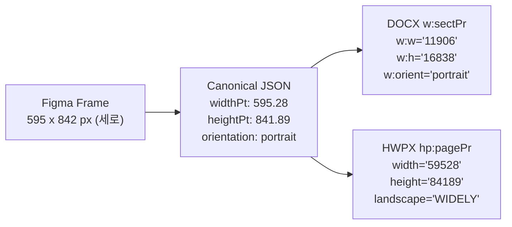
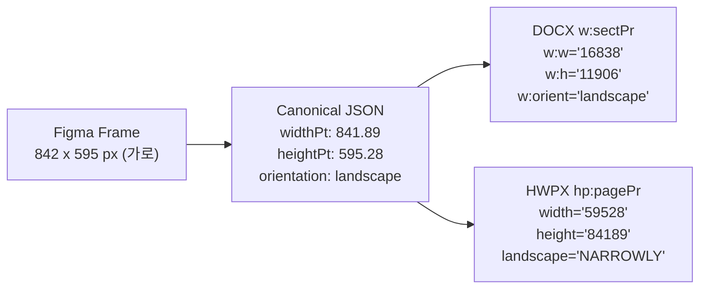

# 크로스 포맷 페이지 기하학 및 좌표계 표준화 비교 분석 (Figma vs Canonical IR vs DOCX vs HWPX)

**작성일**: 2026-10-18  
**연구 분류**: Document Geometry & Cross-Format Serialization Semantics  

---

## 1. 단위 체계 및 좌표계 변환 기준

문서 생성 파이프라인에서 각 포맷은 고유한 길이 단위와 원점 기준을 사용합니다:

| 포맷/계층 | 기본 단위 | 1 pt 환산 비율 | A4 Portrait (세로) 크기 | A4 Landscape (가로) 크기 |
| :--- | :--- | :--- | :--- | :--- |
| **Figma API** | 픽셀 (px) | 1 px = 0.75 pt (72/96) | 794 × 1123 px | 1123 × 794 px |
| **Canonical IR** | 포인트 (pt) | 1 pt = 1.0 pt | 595.28 × 841.89 pt | 841.89 × 595.28 pt |
| **OpenXML DOCX** | 트윕 (twip, 1/20 pt) / EMU | 1 pt = 20 twips | 11906 × 16838 twips | 16838 × 11906 twips |
| **OWPML HWPX** | HWP단위 (HWPUNIT, 1/100 pt) | 1 pt = 100 HWPU | 59528 × 84189 HWPU | 59528 × 84189 HWPU* |

> **중요 (OWPML 규격 제약사항)**:  
> OWPML(KS X 6101)의 `<hp:pagePr>` 엘리먼트는 **용지 정의 시 항상 세로 기준(portrait-base, width <= height)으로 폭과 높이를 선언**해야 합니다. 실제 용지의 회전(가로 모드)은 `landscape="NARROWLY"` 속성을 통해 렌더러가 90도 회전 처리하도록 규정되어 있습니다.

---

## 2. 4대 포맷별 방향 및 크기 메타데이터 매핑 매트릭스

### 2.1 A4 Portrait (세로형) 매핑



- **Figma**: `width: 595.28`, `height: 841.89` (`width < height`)
- **Canonical IR**:
  ```json
  "pageSize": {
    "name": "A4",
    "widthPt": 595.28,
    "heightPt": 841.89,
    "orientation": "portrait"
  }
  ```
- **DOCX**:
  ```xml
  <w:sectPr>
    <w:pgSz w:w="11906" w:h="16838" w:orient="portrait"/>
    <w:pgMar w:top="0" w:right="0" w:bottom="0" w:left="0" w:header="0" w:footer="0" w:gutter="0"/>
  </w:sectPr>
  ```
- **HWPX (수정 후 정상 OWPML)**:
  ```xml
  <hp:pagePr landscape="WIDELY" width="59528" height="84189" gutterType="LEFT_ONLY">
    <hp:margin header="0" footer="0" gutter="0" left="0" right="0" top="0" bottom="0"/>
  </hp:pagePr>
  ```

---

### 2.2 A4 Landscape (가로형) 매핑



- **Figma**: `width: 841.89`, `height: 595.28` (`width > height`)
- **Canonical IR**:
  ```json
  "pageSize": {
    "name": "A4",
    "widthPt": 841.89,
    "heightPt": 595.28,
    "orientation": "landscape"
  }
  ```
- **DOCX**:
  ```xml
  <w:sectPr>
    <w:pgSz w:w="16838" w:h="11906" w:orient="landscape"/>
    <w:pgMar w:top="0" w:right="0" w:bottom="0" w:left="0" w:header="0" w:footer="0" w:gutter="0"/>
  </w:sectPr>
  ```
- **HWPX (수정 후 정상 OWPML)**:
  ```xml
  <hp:pagePr landscape="NARROWLY" width="59528" height="84189" gutterType="LEFT_ONLY">
    <hp:margin header="0" footer="0" gutter="0" left="0" right="0" top="0" bottom="0"/>
  </hp:pagePr>
  ```

---

## 3. 실측 데이터 검증 결과 (`page-geometry-comparison.json`)

`scripts/generate_orientation_fix_artifacts.ts`를 통해 생성된 실측 산출물의 비교 감사 데이터입니다:

| 산출물 | Canonical IR 방향 | HWPX `landscape` 속성 | HWPX 해석 방향 | DOCX `w:orient` 속성 | DOCX 해석 방향 | 일치 여부 |
| :--- | :--- | :--- | :--- | :--- | :--- | :--- |
| `stage6-portrait` | `portrait` (595.28×841.89) | `WIDELY` | **portrait** | `portrait` | **portrait** | **일치 (True)** |
| `stage7-portrait` (9pp) | `portrait` (595.28×841.89) | `WIDELY` | **portrait** | `portrait` | **portrait** | **일치 (True)** |
| `diag-a4-portrait` | `portrait` (595.28×841.89) | `WIDELY` | **portrait** | `portrait` | **portrait** | **일치 (True)** |
| `diag-a4-landscape` | `landscape` (841.89×595.28) | `NARROWLY` | **landscape** | `landscape` | **landscape** | **일치 (True)** |

모든 문서에서 Canonical JSON 단일 원본(SSOT)에 부합하는 완벽한 상호 운용성이 확보되었습니다.

