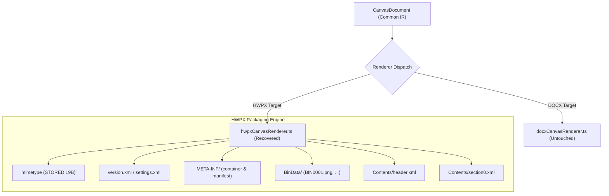

# Phase 20 Implementation Details: HWPX Architecture & OWPML Serialization

본 문서는 `src/canvas/renderer/hwpxCanvasRenderer.ts`에 적용된 완전 복구 아키텍처와 세부 직렬화 로직을 기술한다.

---

## 1. 아키텍처 개요 및 파일 격리 원칙



### 파일 수정 제한 원칙 준수
DOCX 렌더러와 공통 인프라(`docxCanvasRenderer.ts`, `figmaCanvasParser.ts`, `docxCanvasParser.ts`, `svgPathParser.ts`, `types.ts`)는 단 1바이트도 수정하지 않고 원형을 보존하였으며, 모든 복구 로직은 `hwpxCanvasRenderer.ts` 내부에 캡슐화되었다.

---

## 2. 세부 구조 구현

### A. 섹션 구조 (`Contents/section0.xml`)
문단(`<hp:p>`)의 내용 모델 규격인 `(hp:run)*`을 엄격히 준수하기 위해, `<hp:secPr>`를 독립된 `<hp:run charPrIDRef="0">` 내부에 격리 배치하였다.

```xml
<hp:p id="${pIdx}" paraPrIDRef="0" styleIDRef="0"${pageBreakAttr} columnBreak="0" merged="0">
  <hp:run charPrIDRef="0">
    <hp:secPr id="" textDirection="HORIZONTAL" spaceColumns="1134" tabStop="8000" tabStopVal="4000" tabStopUnit="HWPUNIT" outlineShapeIDRef="1" memoShapeIDRef="0" textVerticalWidthHead="0" masterPageCnt="0">
      <hp:grid lineGrid="0" charGrid="0" wonggojiFormat="0"/>
      <hp:startNum pageStartsOn="BOTH" page="${pIdx + 1}" pic="1" tbl="1" equation="1"/>
      <hp:visibility hideFirstHeader="0" hideFirstFooter="0" hideFirstMasterPage="0" border="NONE" fill="NONE" hideFirstPageNum="0" hideFirstEmptyLine="0" showLineNumber="0"/>
      <hp:lineNumberShape restartType="0" countBy="0" distance="0" startNumber="0"/>
      <hp:pagePr landscape="${landscapeAttr}" width="${widthHwpu}" height="${heightHwpu}" gutterType="LEFT_ONLY">
        <hp:margin header="0" footer="0" gutter="0" left="0" right="0" top="0" bottom="0"/>
      </hp:pagePr>
      <hp:footNotePr>
        <hp:autoNumFormat type="DIGIT" userChar="" prefixChar="" suffixChar=")" supscript="0"/>
        <hp:noteLine length="-1" type="SOLID" width="0.12 mm" color="#000000"/>
        <hp:noteSpacing betweenNotes="283" belowLine="567" aboveLine="850"/>
        <hp:numbering type="CONTINUOUS" newNum="1"/>
        <hp:placement place="EACH_COLUMN" beneathText="0"/>
      </hp:footNotePr>
      <hp:endNotePr>
        <hp:autoNumFormat type="DIGIT" userChar="" prefixChar="" suffixChar=")" supscript="0"/>
        <hp:noteLine length="-1" type="SOLID" width="0.12 mm" color="#000000"/>
        <hp:noteSpacing betweenNotes="0" belowLine="567" aboveLine="850"/>
        <hp:numbering type="CONTINUOUS" newNum="1"/>
        <hp:placement place="END_OF_DOCUMENT" beneathText="0"/>
      </hp:endNotePr>
      <hp:pageBorderFill type="BOTH" borderFillIDRef="1" textBorder="PAPER" headerInside="0" footerInside="0" fillArea="PAPER">
        <hp:offset left="0" right="0" top="0" bottom="0"/>
      </hp:pageBorderFill>
    </hp:secPr>
    <hp:ctrl>
      <hp:colPr id="" type="NEWSPAPER" layout="LEFT" colCnt="1" sameSz="1" sameGap="0"/>
    </hp:ctrl>
  </hp:run>
  <!-- 각 도형 런이 순차 배치됨 -->
  <hp:run>...</hp:run>
</hp:p>
```

---

## 3. 공통 도형 직렬화 파이프라인

모든 도형(사각형, 타원, 직선, 다각형, 이미지)은 KS X 6101 표준 sequence에 따라 정확히 15개 하위 요소를 정해진 순서로 방출한다:

1. `<hp:offset x="0" y="0"/>`
2. `<hp:orgSz width="W" height="H"/>`
3. `<hp:curSz width="W" height="H"/>`
4. `<hp:flip horizontal="0" vertical="0"/>`
5. `<hp:rotationInfo angle="0" centerX="W/2" centerY="H/2" rotateimage="1"/>`
6. `<hp:renderingInfo>`: 변환 행렬 3종 (`hc:transMatrix`, `hc:scaMatrix`, `hc:rotMatrix`)
7. `<hp:lineShape>`: 테두리 색상, 두께, 스타일, 캡
8. `<hc:fillBrush>`: 채우기 브러시 (직선 및 이미지는 생략)
9. `<hp:drawText>`: 내부 텍스트 및 서브리스트 (`<hp:subList>` 및 `<hp:textMargin>`)
10. 이미지 전용 블록 (`<hp:imgRect>`, `<hp:imgClip>`, `<hp:inMargin>`, `<hp:imgDim>`, `<hc:img>`, `<hp:effects/>`)
11. `<hp:shadow type="NONE" color="#B2B2B2" offsetX="0" offsetY="0" alpha="0"/>`
12. 도형별 고유 기하 좌표 (Geometry)
13. `<hp:sz width="W" height="H" widthRelTo="ABSOLUTE" heightRelTo="ABSOLUTE" protect="0"/>`
14. `<hp:pos treatAsChar="0" affectLSpacing="0" flowWithText="0" allowOverlap="1" holdAnchorAndSO="1" vertRelTo="PAPER" horzRelTo="PAPER" vertAlign="TOP" horzAlign="LEFT" vertOffset="Y" horzOffset="X"/>`
15. `<hp:outMargin left="0" right="0" top="0" bottom="0"/>`

---

## 4. 도형별 고유 기하 좌표계 공식

### 1) 사각형 (`hp:rect`)
- 속성: `ratio="${ratio}"` (0~50 캡핑)
- 지오메트리:
  ```xml
  <hc:pt0 x="0" y="0"/>
  <hc:pt1 x="${w}" y="0"/>
  <hc:pt2 x="${w}" y="${h}"/>
  <hc:pt3 x="0" y="${h}"/>
  ```

### 2) 타원 (`hp:oval`)
- 속성: `intervalDirty="0" hasArcPr="0" arcType="NORMAL"`
- 지오메트리:
  ```xml
  <hc:center x="${cx}" y="${cy}"/>
  <hc:ax1 x="${cx}" y="0"/>
  <hc:ax2 x="${w}" y="${cy}"/>
  <hc:start1 x="0" y="0"/>
  <hc:end1 x="0" y="0"/>
  <hc:start2 x="0" y="0"/>
  <hc:end2 x="0" y="0"/>
  ```
  - 중심점: $cx = \lfloor w / 2 \rfloor, cy = \lfloor h / 2 \rfloor$
  - 축 1 (수직 반경 끝점): $(cx, 0)$
  - 축 2 (수평 반경 끝점): $(w, cy)$
  - 시작/끝점: 닫힌 타원의 경우 $(0, 0)$

### 3) 직선 (`hp:line`)
- 속성: `isReverseHV="0"`
- 지오메트리:
  ```xml
  <hc:pt0 x="${p0.x}" y="${p0.y}"/>
  <hc:pt1 x="${p1.x}" y="${p1.y}"/>
  ```

### 4) 다각형 (`hp:polygon`)
- 지오메트리:
  각 정점마다 `<hc:pt x="${p.x}" y="${p.y}"/>` 방출.

### 5) 그림 (`hp:pic`)
- 속성: `numberingType="PICTURE" reverse="0"`
- 지오메트리 및 리소스:
  ```xml
  <hp:imgRect>
    <hc:pt0 x="0" y="0"/>
    <hc:pt1 x="${w}" y="0"/>
    <hc:pt2 x="${w}" y="${h}"/>
    <hc:pt3 x="0" y="${h}"/>
  </hp:imgRect>
  <hp:imgClip left="${clipLeft}" right="${clipRight}" top="${clipTop}" bottom="${clipBottom}"/>
  <hp:inMargin left="0" right="0" top="0" bottom="0"/>
  <hp:imgDim dimwidth="${dimW}" dimheight="${dimH}"/>
  <hc:img binaryItemIDRef="${binId}" bright="0" contrast="0" effect="REAL_PIC" alpha="0"/>
  <hp:effects/>
  ```

---

## 5. 도형 ID 발급기 (`unsignedInt`)

기존 레거시 렌더러가 복합 경로에 대해 `1_1`, `1_1_1` 등의 문자열 ID를 생성하여 스키마 검증을 실패시키던 문제를 해결하기 위해, 렌더링 세션마다 단일 순차 정수 생성기(`const nextId = () => globalShapeId++;`)를 주입하였다.
모든 단일 도형, 벡터 서브패스 분할선, 다각형은 독립적이고 충돌 없는 정수 ID(`1, 2, 3, ...`)를 부여받는다.

---

## 6. 헤더 및 글꼴/스타일 테이블 (`Contents/header.xml`)

1. **루트 속성**: `<hh:head ... version="1.2" secCnt="${secCnt}">`
2. **7대 표준 언어 글꼴 블록**:
   - `HANGUL`, `LATIN`, `HANJA`, `JAPANESE`, `OTHER`, `SYMBOL`, `USER` 모두 정품 규격에 맞춰 대문자 열거형으로 선언.
3. **스타일 테이블 인덱스 일관성**:
   - `charPrIDRef` 및 `paraPrIDRef`가 본문의 `hp:run` 및 `hp:p`와 1:1 정확히 대응되도록 등록 및 역인덱싱.

