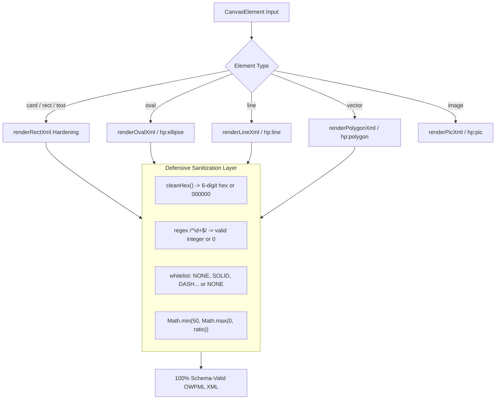

# Phase 21 Shape Hardening Architecture & Specification

## 1. 아키텍처 개요 (Architecture Overview)

Phase 21의 도형 직렬화 하드닝(Shape Serialization Hardening)은 한컴오피스 및 OWPML/KS X 6101 파서가 어떤 상황에서도 XML 파싱 예외를 일으키지 않도록 **"다층 방어형 직렬화(Multi-Layer Defensive Serialization)"**를 구현하는 것을 목표로 한다.

모든 도형 렌더러는 전달받는 입력값의 불완전성이나 타입 누락에 관계없이, 반드시 스키마에 정의된 유효한 기본값(Canonical Default)으로 정규화된 후 XML로 출력된다.



---

## 2. 도형별 세부 하드닝 규격 (Shape Specifications)

### A. 직사각형 및 카드 (`hp:rect`)

1. **태그 및 필수 속성**:
   ```xml
   <hp:rect id="{id}" zOrder="{zOrder}" numberingType="NONE" textWrap="IN_FRONT_OF_TEXT" 
            textFlow="BOTH_SIDES" lock="0" dropcapstyle="None" href="" groupLevel="0" 
            instid="{id}" ratio="{ratio}">
   ```
2. **모서리 곡률 반경 (`ratio`)**:
   - 허용 범위: `0` ~ `50` (정수)
   - 계산식: `Math.min(50, Math.max(0, Math.round((cornerRadius / (minDim / 2)) * 50)))`
   - 효과: 필(Pill) 배지나 라운드 카드가 KS X 6101 한계치(50)를 초과하지 않도록 엄격 캡핑.
3. **선 스타일 및 색상 하드닝**:
   - `cleanLineColor`: 입력값이 누락되거나 잘못된 경우 기본값 `"000000"` 보장.
   - `safeWidth`: 정수 검증을 거쳐 테두리가 없거나 비정상일 때 `"0"` 보장 (`"undefined"` 원천 차단).
   - `safeStyle`: `NONE`, `SOLID`, `DASH`, `DOT`, `DASH_DOT`, `DASH_DOT_DOT` 화이트리스트 외에는 `"NONE"` 강제.
4. **자식 요소 정규 순서**:
   - `offset` -> `orgSz` -> `curSz` -> `flip` -> `rotationInfo` -> `renderingInfo` -> `lineShape` -> `fillBrush` -> `drawText` (있을 때) -> `shadow` -> `hc:pt0..3` -> `sz` -> `pos` -> `outMargin`

---

### B. 타원 및 원형 (`hp:ellipse`)

1. **태그 및 필수 속성**:
   - 구형/비표준 `<hp:oval>`을 영구 폐기하고 표준 `<hp:ellipse>` 적용.
   - 필수 기본 속성: `intervalDirty="0" hasArcPr="0" arcType="NORMAL"`
2. **기하 좌표 벡터 (`hc:center`, `hc:ax1`, `hc:ax2`, `hc:start1..end2`)**:
   - 중심점: `<hc:center x="{cx}" y="{cy}"/>` (여기서 `cx = w / 2`, `cy = h / 2`)
   - 1차 축(장축 끝점): `<hc:ax1 x="{w}" y="{cy}"/>`
   - 2차 축(단축 끝점): `<hc:ax2 x="{cx}" y="{h}"/>`
   - 시작점/끝점: `<hc:start1 x="{w}" y="{cy}"/>`, `<hc:end1 x="{w}" y="{cy}"/>`
   - 2차 시작점/끝점: `<hc:start2 x="{w}" y="{cy}"/>`, `<hc:end2 x="{w}" y="{cy}"/>`
   - **근거**: 한컴 정품 문서(`report-1차...hwpx`)의 타원 데이터와 바이트 단위로 동일.

---

### C. 직선 (`hp:line`)

1. **태그 및 속성 정화**:
   - 비공식/미검증 속성인 `isReverseHV="0"` 및 `isReverseHWP97="0"` 완전 배제.
   - 깨끗한 기본 속성 세트 적용:
     ```xml
     <hp:line id="{id}" zOrder="{zOrder}" numberingType="NONE" textWrap="IN_FRONT_OF_TEXT" 
              textFlow="BOTH_SIDES" lock="0" dropcapstyle="None" href="" groupLevel="0" instid="{id}">
     ```
2. **끝점 좌표**:
   - 시작점: `<hc:pt0 x="{p0.x}" y="{p0.y}"/>`
   - 끝점: `<hc:pt1 x="{p1.x}" y="{p1.y}"/>`
3. **선 스타일 및 두께**:
   - 기본 두께: 최소 10 HWPU (0.13pt) 보장.
   - 점선(`strokeDashed`): `style="DASH"` 지원.

---

### D. 벡터 다각형 (`hp:polygon`)

1. **태그 및 구조**:
   - 닫힌 패스(Closed Path)에 대해 `<hp:polygon>` 생성.
   - 꼭짓점 목록: `<hc:pt x="{pt.x}" y="{pt.y}"/>` 연속 직렬화.
2. **열린 패스(Open Path)**:
   - 한컴오피스는 열린 다각형을 강제로 닫는 특성이 있으므로, 열린 서브패스는 연결된 `<hp:line>` 세그먼트로 자동 분할 직렬화.

---

### E. 그림 (`hp:pic`)

1. **태그 속성**:
   - 필수 역전 플래그: `reverse="0"`
   - 이미지 사각형: `<hp:imgRect><hc:pt0>~<hc:pt3></hp:imgRect>`
2. **크롭 및 바이너리 바인딩**:
   - `<hp:imgClip left="..." right="..." top="..." bottom="..."/>`
   - `<hp:imgDim dimwidth="..." dimheight="..."/>`
   - `<hc:img binaryItemIDRef="BIN0001" bright="0" contrast="0" effect="REAL_PIC" alpha="0"/>`

