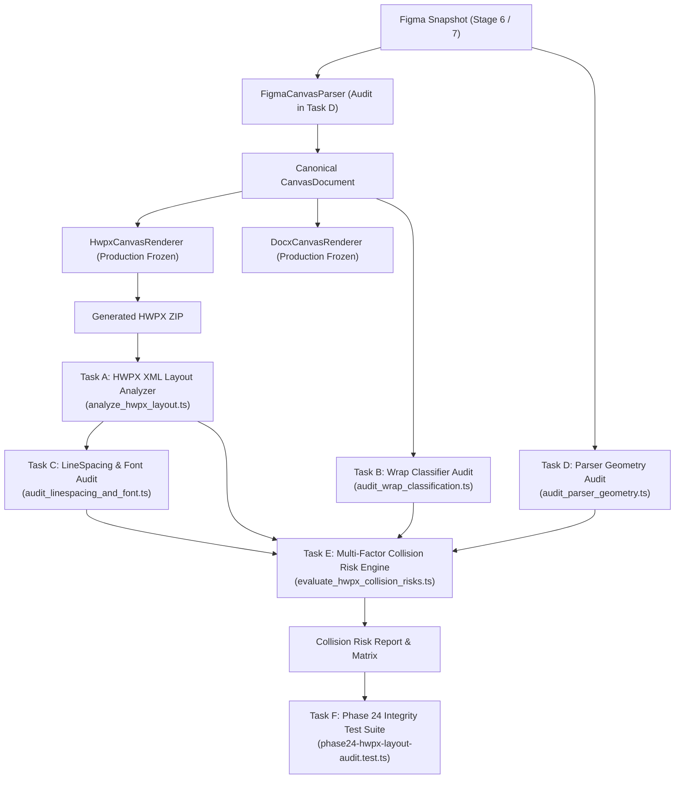

# 01. Phase 24: Architecture, Diagnostic Scope & Hardening Principles

## 1. 개요 및 배경

Figma2Word 프로젝트는 Figma 디자인 데이터를 단일 기준 원본(Single Source of Truth)인 Canonical JSON (Canvas IR)으로 변환한 후, 독립적인 DOCX 렌더러와 HWPX 렌더러를 통해 무손실 편집 가능 문서를 생성하는 로컬 컴파일러입니다.

- **현재 커밋**: `ce5176f`
- **목적**: HWPX 렌더러의 텍스트 겹침 문제에 대한 **자동화된 XML 정합성 검증 체계, 단일행/다중행 분류 공통 모델, 행간·폰트 메트릭 감사, 파서 기하학 전이 감사, 충돌 위험도 산출 파이프라인**을 완성하여 추후 프로덕션 변경 시 회귀 위험을 제로화하는 것입니다.

---

## 2. 변경 불가능한 프로덕션 보호 원칙

본 Phase 24에서는 다음 불변 원칙을 철저히 준수합니다.

1. **프로덕션 코드 동결 (Production Code Frozen)**:
   - `src/canvas/renderer/hwpxCanvasRenderer.ts`
   - `src/canvas/renderer/docxCanvasRenderer.ts`
   - `src/canvas/parser/figmaCanvasParser.ts`
   - `src/canvas/types.ts`
   위 모든 프로덕션 소스는 1바이트도 수정하지 않습니다.
2. **단일 원본 (Canonical JSON SSoT) 보존**:
   - 렌더러별 편법 하드코딩이나 포맷별 비대칭 우회를 금지합니다.
3. **증거 기반 및 추정치 명시**:
   - 자동 테스트 통과를 실제 뷰어에서의 시각적 무결성 달성의 증거로 단정하지 않습니다.
   - 모든 렌더링 폭/높이 계산값은 "추정치(Estimation)"로 명확히 라벨링합니다.

---

## 3. 핵심 감사 및 진단 파이프라인 구조

---

## 4. 진단 및 감사 대상 코퍼스

| 스테이지 | 원본 입력 스냅샷 | 생성 HWPX 경로 | 검증 특성 |
|---|---|---|---|
| **Stage 6** | `samples/real-world/sample-a-proposal-doc.json` | `debug/hwpx-recovery/stage6-representative-report.hwpx` | 1페이지 제안서, 대형 요약 단락, KPI 지표 |
| **Stage 7** | `debug/customer/Report1-Live-Snapshot.json` | `debug/hwpx-recovery/stage7-full-report.hwpx` | 9페이지 실무 외벽 진단 보고서, 424개 텍스트, 복합 차트 |
| **MRE Suite** | `Report1-Live-Snapshot.json` 추출 2페이지 | `debug/hwpx-overlap-mre/mre-A~F.hwpx` | 6종 단일 변수 분리 실험 문서 |
| **정품 레퍼런스** | - | `완성본-20261012/report-1차-진단-편집가능-최종보정.hwpx` | 한컴 정품 상용 최종 보정 문서 (429개 텍스트) |

