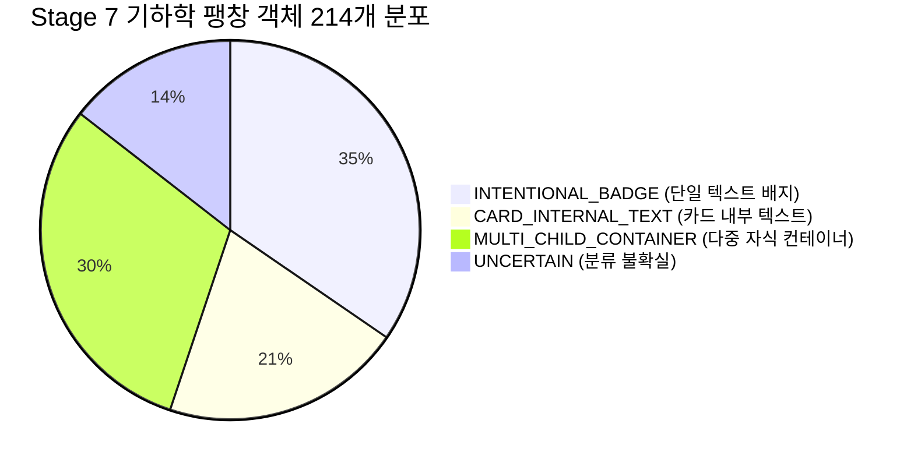

# 05. Figma Parser Geometry Preservation & Centering Heuristic Audit

## 1. 개요 및 조사 배경

Stage 7 검증 과정에서 Page 2의 `7:1082` 배너("품질 가공 단계: AI 원검출 → 노이즈 제거 → 중첩 보정 → 정제 1,248개 기준")가 수직으로 아래쪽으로 심하게 밀려 아이콘 및 카드 배경과의 정렬이 파괴되는 현상이 관찰되었습니다.

본 조사는 `figmaCanvasParser.ts` 내부의 컨테이너 수직 정렬 휴리스틱(`isCenteredInParent`)이 원본 Figma 좌표 및 높이를 어떻게 변형시키는지 전수 추적한 감사 보고서입니다.

---

## 2. `isCenteredInParent` 휴리스틱 구현 분석

`src/canvas/parser/figmaCanvasParser.ts:528-558` 구현부:

```typescript
// Check if text is vertically centered in parent container (badge, button, table cell, row)
if (
  node.id !== frame.id &&
  parentBox &&
  childBox &&
  parentBox.height < 600 &&
  parentBox.height > childBox.height + 2
) {
  const topGap = childBox.y - parentBox.y;
  const bottomGap = (parentBox.y + parentBox.height) - (childBox.y + childBox.height);
  const isSymmetric = Math.abs(topGap - bottomGap) <= 2.5;

  // Only consider centered if parent is NOT a vertical stack of multiple children
  const isVerticalStack =
    (node as any).layoutMode === "VERTICAL" &&
    node.children &&
    node.children.length > 1;

  if (isSymmetric && !isVerticalStack) {
    isCenteredInParent = true;
    verticalAlign = "center";
    const parentRelY = parentBox.y - frameBox.y;
    textYPt = parentRelY * scaleY;
    textHPt = parentBox.height * scaleY;
  }
}
```

### 동작 메커니즘:
1. 텍스트가 부모 박스 내에서 상하 대칭 여백(`isSymmetric <= 2.5px`)을 가지면,
2. 텍스트 요소의 `bounds.height`를 **부모 컨테이너의 전체 높이(`parentBox.height`)로 강제 확장**하고,
3. 텍스트의 원래 높이는 `contentHeightPt`에 보존하며,
4. `verticalAlign`을 `"center"`로 변경합니다.

---

## 3. Stage 6 및 Stage 7 전수 기하학 변형 실측

`scripts/audit_parser_geometry.ts`를 통한 전수 분석 결과입니다.

| 데이터셋 | 전체 텍스트 수 | 기하학 변형(팽창) 객체 수 | 변형 비율 (%) |
|---|---|---|---|
| **Stage 6 (제안서)** | 5개 | **1개** (`1:38` 단일 배지) | **20.0%** |
| **Stage 7 (고객 보고서)** | 424개 | **214개** | **50.5%** |

### 5대 유형별 분류 결과 (Stage 7):



1. **`INTENTIONAL_BADGE` (74개, 34.6%)**:
   - 부모 높이 26pt 이하, 자식 1개인 작은 배지/칩.
   - 중앙 정렬이 의도된 정상 케이스.
2. **`CARD_INTERNAL_TEXT` (44개, 20.6%)**:
   - 부모 카드(높이 30~80pt) 내부에 배치된 단일 텍스트.
   - **위험군**: 부모 높이로 팽창되어 HWPX에서 baseline이 카드 바닥으로 처지는 결함 발생 (`7:1082` 포함).
3. **`MULTI_CHILD_CONTAINER` (65개, 30.4%)**:
   - 아이콘, 라벨, 수치 등이 함께 들어있는 복합 컨테이너.
   - **고위험군**: 텍스트 박스가 컨테이너 전체를 덮으면서 주변 형제 요소의 마우스 클릭/선택을 방해하고 BBox 충돌 유발.
4. **`UNCERTAIN` (31개, 14.5%)**:
   - 모호한 복합 레이아웃.

---

## 4. `7:1082` 배너 왜곡 사례 상세 포렌식

- **객체명**: `"품질 가공 단계: AI 원검출 → 노이즈 제거 → 중첩 보정 → 정제 1,248개 기준"`
- **Figma 원본 텍스트 크기**: `width: 407px, height: 16px` (12.0pt)
- **부모 카드 (`7:1080`)**: `width: 686px, height: 50px` (37.5pt, 자식 2개: 아이콘 `7:1081` + 텍스트 `7:1082`)
- **파서 처리 결과**:
  - `bounds.y`: 497.04 pt (부모 카드의 상단 y)
  - `bounds.height`: **37.48 pt (3.13배 팽창)**
  - `contentHeightPt`: **11.99 pt** (원래 텍스트 높이)
  - `verticalAlign`: `"center"`
- **HWPX 직렬화 시 파괴적 결과**:
  - `hwpxCanvasRenderer.ts`는 `contentHeightPt`(11.99pt)를 버리고 `bounds.height`(37.48pt)로 `<hp:rect>`를 생성함.
  - 여기에 `vertAlign="CENTER"`와 160% 행간이 결합되어, 텍스트가 37.48pt 박스의 정중앙 하단에 박히면서 위쪽 아이콘(`7:1081`)과 수평 축이 어긋나고 카드 바닥에 글자가 붙어버림.

---

## 5. 회귀 위험 및 개선 권고안

1. **파서 로직 직접 수정의 위험**:
   - 파서에서 `isCenteredInParent`를 전면 제거하면, 74개의 정상 배지(`INTENTIONAL_BADGE`)에서 텍스트가 상단으로 치우치는 대규모 시각적 회귀가 발생함.
2. **안전한 해결 경로 (Safe Remediation Path)**:
   - 파서 로직은 그대로 유지하여 `contentHeightPt`를 풍부하게 보존하도록 두고,
   - **HWPX 렌더러 측에서 `contentHeightPt`가 존재할 때, `<hp:rect>`의 물리 높이를 `contentHeightPt`로 제한하고 수직 중심 위치(`vertOffset`)를 계산하여 배치**하는 렌더러 사이드 방어책을 적용하는 것이 가장 안전함.

