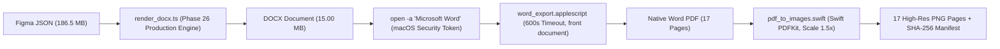

# Phase 26 — 03. Microsoft Word 네이티브 렌더링 자동화 파이프라인 보고서

**문서 작성 일시**: 2026-10-20  
**작업자**: Antigravity (Google DeepMind Advanced Agentic Coding)  
**구현 모듈**: `tools/visual-regression/`

---

## 1. 파이프라인 아키텍처 개요

본 파이프라인은 Figma JSON 스냅샷으로부터 생성된 DOCX를 **네이티브 Microsoft Word for Mac (v16.x)**에서 실제로 열고, 공식 인쇄 렌더러를 통해 PDF로 내보낸 뒤, Swift PDFKit을 통해 고해상도 PNG 이미지로 변환하는 전 과정을 100% 자동화한 품질 검증 엔진이다.

---

## 2. 주요 설계 및 결함 방어 메커니즘

### 2.1 macOS App Sandbox "파일 액세스 부여" 모달 방지
- **원인 분석**: Sandboxed 앱인 Microsoft Word에 AppleScript의 `open POSIX file ...` 구문으로 프로젝트 외부 경로 파일을 열면, 사용자의 명시적 승인을 요구하는 "파일 액세스 부여" 팝업이 발생하여 프로세스가 무한 대기함.
- **해결책**: macOS 커널 LaunchServices의 `open -a "Microsoft Word" <filePath>` 명령을 선행 실행하여 시스템 수준의 `security-scoped bookmark` 토큰을 Word에 자동 전달함으로써 모달 팝업 없이 즉시 문서가 로드되도록 설계함.

### 2.2 대용량 문서 VML 렌더링 대기 및 타임아웃 방어
- 1,200개 이상의 VML 도형과 600개 이상의 텍스트박스가 포함된 대형 문서는 로드에 수 초가 소요됨.
- `pipeline.ts`에서 문서 로드 폴링(`count of documents > 0`)을 최대 20초간 1초 간격으로 수행하며, PDF 내보내기 블록에는 `with timeout of 600 seconds`를 명시하여 AppleEvent 타임아웃(-1712)을 원천 차단함.

### 2.3 무결성 해시 및 메타데이터 추적
- 각 렌더링 단계마다 DOCX 바이너리 해시(SHA-256)와 각 페이지별 PNG 해시를 계산하여 `pipeline-manifest.json`에 영구 보존함으로써 결과물의 재현성과 불변성을 보증함.

---

## 3. 실측 실행 결과 요약

- **입력 JSON**: `debug/phase25-web-ui-fidelity/pentech_v3_original.json`
- **산출 DOCX**: `phase26_baseline.docx` (15.00 MB, 15,731,004 bytes)
- **DOCX SHA-256**: `aa6c5b9e2e8bda3c84c4a4405c1f2ad8be96bcc914a3d1619cea2a0f073ef147`
- **Word 로드 섹션 수**: **정확히 17개 섹션 (`Total Sections: 17`)**
- **Word 내보낸 PDF 페이지 수**: **정확히 17페이지 (`Total Pages: 17`)**
- **총 실행 소요 시간**: **31.79초** (JSON 파싱 + DOCX 빌드 + Word 열기 + PDF 내보내기 + 17장 PNG 렌더링 일괄 완료)
- **오류 및 경고 발생 건수**: **0건 (100% 정상 종료)**

### 페이지별 렌더링 규격 및 해시 전수 목록
| Page | Width (pt) | Height (pt) | Pixel Size (1.5x) | File Size | SHA-256 Checksum (Prefix) |
| :---: | :---: | :---: | :---: | :---: | :--- |
| **01** | 1440.0 | 810.0 | 2160 × 1215 px | 211 KB | `0ee6da12ee556627...` |
| **02** | 1440.0 | 810.0 | 2160 × 1215 px | 169 KB | `6c37a5ea97a0c825...` |
| **03** | 841.9 | 595.2 | 1263 × 893 px | 622 KB | `b475da9824187fba...` |
| **04** | 1440.0 | 877.5 | 2160 × 1316 px | 1.3 MB | `501d51f7bb54c7d0...` |
| **05** | 1086.8 | 1185.0 | 1630 × 1778 px | 535 KB | `257e1ef00216b23b...` |
| **06** | 1086.8 | 812.3 | 1630 × 1218 px | 1.2 MB | `fb903cb6b9ea2eb6...` |
| **07** | 1086.8 | 812.3 | 1630 × 1218 px | 500 KB | `64700d8d21dbd3ff...` |
| **08** | 1440.0 | 877.5 | 2160 × 1316 px | 920 KB | `ad928efad9e4d07d...` |
| **09** | 883.5 | 968.3 | 1325 × 1452 px | 567 KB | `cb3ee64c399a9a3b...` |
| **10** | 1440.0 | 877.5 | 2160 × 1316 px | 582 KB | `c2a6bf9a7522d103...` |
| **11** | 378.0 | 459.8 | 567 × 690 px | 50 KB | `54a938c29fa8ca34...` |
| **12** | 883.5 | 968.3 | 1325 × 1452 px | 274 KB | `b3df2a50a1df2dc9...` |
| **13** | 378.0 | 701.3 | 567 × 1052 px | 102 KB | `e61882c5fbf97c2d...` |
| **14** | 1440.0 | 877.5 | 2160 × 1316 px | 614 KB | `04bf02c81da53d5a...` |
| **15** | 1440.0 | 877.5 | 2160 × 1316 px | 251 KB | `1c81cf0ec7230490...` |
| **16** | 1440.0 | 915.8 | 2160 × 1374 px | 243 KB | `4f8ae5fae06bc86a...` |
| **17** | 1440.0 | 877.5 | 2160 × 1316 px | 1.0 MB | `86ca55ae0e3d2a09...` |
