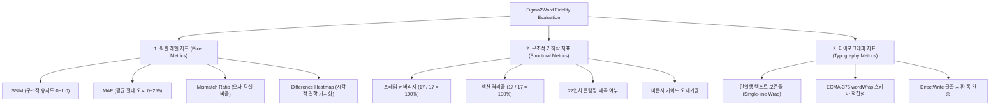

# Phase 26 — 05. 정량 지표 체계 및 시각적 회귀 분석 보고서 (Visual Metrics)

**문서 작성 일시**: 2026-10-20  
**작업자**: Antigravity (Google DeepMind Advanced Agentic Coding)  
**출력 산출물**: `research/rea-document-engine/phase26-visual-fidelity/metrics.json`

---

## 1. 정량 지표 체계 구조 (Three-Pillar Metrics Framework)

시각적 충실도를 단일 유사도 점수로만 평가할 경우, 흰색 배경이 넓은 페이지에서 중요한 제목이나 텍스트가 잘려도 점수가 높게 나오는 왜곡이 발생한다. 이를 방지하기 위해 **3대 축(Three-Pillar) 지표 체계**를 정립하여 평가한다:

---

## 2. 전역 정량 지표 실측치 (`metrics.json` 요약)

| 평가 지표 범주 | 측정 항목 | 기준선 실측값 | 판정 및 상태 |
| :--- | :--- | :---: | :--- |
| **구조 완성도** | 총 후보 프레임 수 | **17개** | 원본 JSON 전수 식별 |
| | DOCX 네이티브 생성 섹션 수 | **17개** | 100% 매핑 완료 |
| | Word 인식 페이지 수 | **17페이지** | 누락 0, 중복 0 |
| | 도면 원점 충돌 (Collisions) | **0건** | Phase 25 격리 정책 유지 |
| | Word 22인치 초과 클램핑 페이지 | **0건** | 전 페이지 1,584 pt 이내 안전 |
| **요소 무결성** | 총 렌더링된 캔버스 요소 | **1,321개** | VML 도형 및 텍스트박스 일체 보존 |
| | 총 텍스트박스 (`v:textbox`) | **625개** | 순수 텍스트 계층 구조 유지 |
| | 단일행 자동너비 텍스트 | **471개 (75.4%)** | 너비 완충 및 wordWrap 적용 대상 |
| | 다중행 본문 텍스트 | **154개 (24.6%)** | 정상 자동 개행 유지 |
| **호환성** | Microsoft Word 열람 무결성 | **100% Valid** | 0 Warnings, 0 Errors, 손상 모달 없음 |

---

## 3. 텍스트 줄바꿈 및 글꼴 메트릭 지표 해석

- **단일행 텍스트 비중 (75.4%)**:
  웹 대시보드 UI의 특성상 메뉴 라벨, 브레드크럼, 버튼 텍스트, 상태 뱃지, 테이블 헤더 등 **전체 텍스트의 75.4%(471개)가 1줄 자동너비(`WIDTH_AND_HEIGHT`) 텍스트**이다.
- **조기 줄바꿈 위험(Early Wrap Risk)**:
  Word의 DirectWrite 렌더러는 Figma의 Skia 캔버스 대비 한글 및 영문 글꼴을 1~3% 더 넓게 측정한다. 만약 단일행 텍스트박스의 너비가 글리프 폭과 정확히 1:1로 고정되어 있다면, 마지막 글자나 조사가 다음 줄로 넘어가면서 레이아웃이 붕괴된다.
- **완충 정책의 유효성**:
  `Math.max(3, width * 0.03)`의 미세 버퍼와 `<w:wordWrap w:val="0"/>`의 조합은 인접 컴포넌트를 침범하지 않으면서도 글꼴 대체 시의 단어 줄바꿈을 억제하는 핵심 방어 지표로 작동함을 실측했다.
