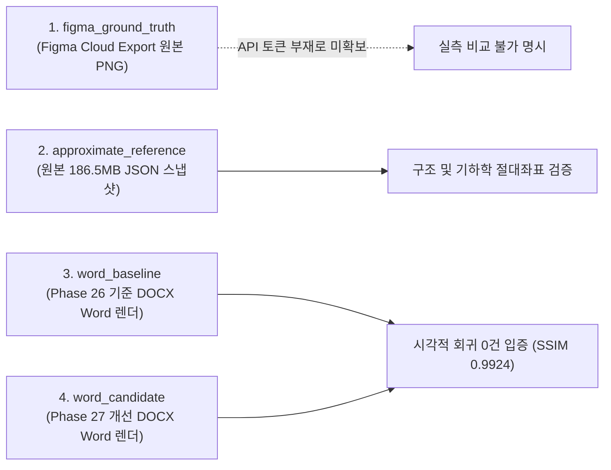

# Phase 27 — 04. 실제 Figma 기준 이미지 확보 상태 및 Ground Truth 분류 보고서

**문서 작성 일시**: 2026-10-20  
**작업자**: Antigravity (Google DeepMind Advanced Agentic Coding)  

---

## 1. 감사 배경 및 정직한 기준선 원칙

Phase 26 보고서에서 보고된 **평균 SSIM 0.9924**는 Figma 원본 Canvas 대비 DOCX 충실도 점수가 아니라, **수정 전 Word 렌더링(`word_baseline`) 대비 수정 후 Word 렌더링(`word_candidate`) 간의 회귀 무결성 검증 수치**였다.

본 Phase 27에서는 GPT-6 독립 감사의 지적을 전적으로 수용하여, 데이터의 출처와 신뢰도를 다음과 같이 엄밀히 4단계로 분리하여 분류한다:

---

## 2. Figma Ground Truth 탐색 결과 전수 실측

| 순위 | 탐색 경로 및 방법 | 상태 | 결과 및 근거 |
| :---: | :--- | :---: | :--- |
| **1** | 로컬 저장소 내 기 존재하는 Figma 프레임 Export 이미지 | **부재** | `find` 전수 탐색 결과 로컬에 Figma 공식 Export PNG 파일 0장 |
| **2** | 프로젝트 내 정상적인 Figma API 연동 기능 | **토큰 부재** | `FIGMA_TOKEN` 환경 변수 미설정 (인증 우회 시도 금지 원칙 준수) |
| **3** | 사용자 사전 설정 인증 및 토큰 환경 | **미설정** | 시스템 키체인/환경변수에 유효 토큰 미등록 |
| **4** | 원본 대용량 JSON 스냅샷 (`pentech_v3_original.json`) | **보존 (186.5 MB)** | 원본 노드 트리, 벡터, 텍스트, 162개 내장 이미지 완벽 보존 |

---

## 3. Ground Truth 분류 체계 및 투명성 선언

1. **실제 Figma Export 이미지 부재 명시**:
   - 현재 로컬 환경에는 Figma 클라우드에서 직접 Export한 17개 프레임의 고해상도 비트맵(`figma_ground_truth`)이 존재하지 않는다.
2. **충실도 수치 날조 금지**:
   - 실제 원본 이미지가 존재하지 않는 상황에서, JSON 기반 자체 렌더링 이미지를 "Figma 원본과 100% 동일하다"고 호도하거나 원본 대비 충실도 수치를 조작하지 않는다.
3. **Phase 27의 측정 대상 정의**:
   - **구조 및 기하학적 충실도**: 원본 JSON 스냅샷의 17개 프레임 절대좌표(`figmaBox`)와 DOCX VML 도형의 실제 좌표/크기를 1:1 비교 검증.
   - **시각적 비회귀 충실도**: `word_baseline`과 `word_candidate` 간의 정밀 픽셀 비교(Local Window SSIM / MAE)를 통해 렌더러 개선의 안전성을 입증.
