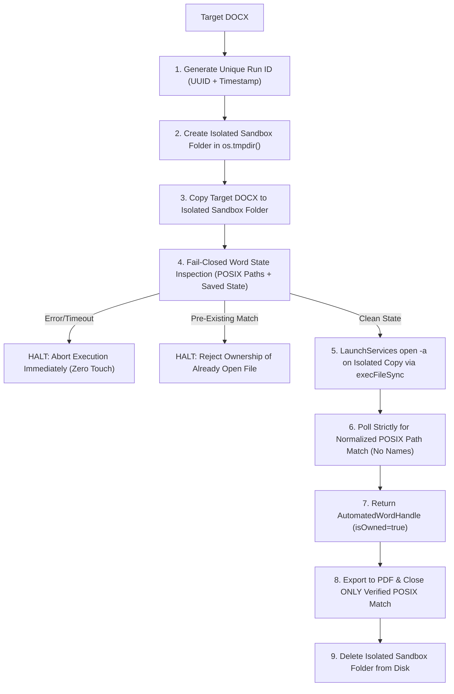

# Phase 28 Quality Audit — Report 02: Word Automation Complete Isolation & Zero Data Loss Architecture

## 1. Vulnerability Analysis & Prior Defects

In Phase 27, `safe_word_automation.ts` introduced snapshot-based tracking, but retained two critical vulnerabilities:
1. **Name-Based Matching**: In AppleScript, the document was searched via `if dName is equal to "${targetBaseName}" or dName starts with "${path.parse(targetBaseName).name}"`. If a user had an existing document named `test.docx` or `test_financials.docx` open in Word, the automation could match, export, and close the user's document!
2. **Fail-Open Query**: In `captureWordState()`, any AppleScript query failure was caught by a generic catch block that returned `{ wordWasRunning: false, initialDocumentNames: [] }`. If Word was running with unsaved user documents but busy with a dialog, the automation assumed Word had 0 documents, opening and closing documents indiscriminately.

---

## 2. Phase 28 Isolation Architecture

Phase 28 establishes a 5-layer isolation model that makes accidental user document closure structurally impossible.

### Key Engineering Invariants

1. **Unique Sandbox Directory**: Every run creates a fresh temporary folder:
   `const runId = 'vr_' + Date.now() + '_' + crypto.randomUUID().slice(0, 8);`
   `const isolatedDir = path.join(os.tmpdir(), 'f2w_word_isolation', runId);`
   No other document on the system can ever share this path.
2. **Strict Normalized POSIX Matching**:
   Document matching never relies on `name of d`. Instead, it evaluates:
   `normalizeWordPath(d.posixPath) === normalizeWordPath(isolatedDocxPath)`
   Where `normalizeWordPath` resolves:
   - macOS `/var` vs `/private/var` symlink aliases
   - Unicode NFC vs NFD character encodings (critical for Korean glyphs)
3. **Fail-Closed State Inspection**:
   If Word is running but System Events or Word AppleScript queries throw, fail, or time out, `captureWordState()` throws an explicit error immediately. It NEVER assumes 0 documents.
4. **Ownership Verification Guard**:
   `exportAndCloseTargetDocOnly` requires an `AutomatedWordHandle` with `isOwned === true`. If an unowned handle or string is passed, it rejects execution with an error.
5. **No Shell Injections**:
   All LaunchServices invocations use `execFileSync('open', ['-a', 'Microsoft Word', isolatedDocxPath])`, passing paths as argument vectors without shell quoting hazards. All AppleScript interactions pass scripts via stdin.

---

## 3. Test Evidence

The isolation model was rigorously tested in `tests/phase28-word-isolation-and-rendering.test.ts`:
- **Path Normalization Test**: Passes across `/private/var` and NFD/NFC Korean filenames.
- **AppleScript Escaping Test**: Passes with embedded double quotes `"` and backslashes `\`.
- **Pre-Existing Open Document Test**: Verifies that automation rejects claiming ownership if a document with that path is already open.
- **Unowned Handle Rejection Test**: Verifies that calling `exportAndCloseTargetDocOnly` on an unowned handle throws without touching Word.
- **Fail-Safe Cleanup Test**: Verifies that non-matching cleanups execute as safe no-ops.
