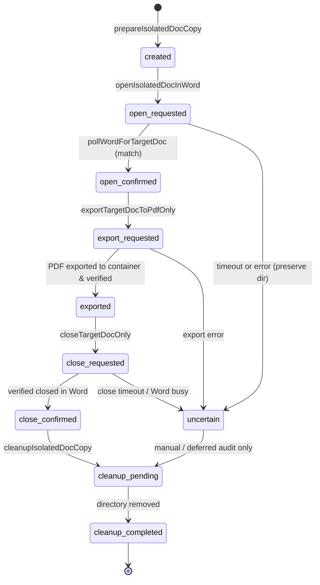

# 02. Word Automation Lifecycle & Safe Concurrency Architecture

## 1. Lifecycle State Machine Definition

In Phase 30, `tools/visual-regression/safe_word_automation.ts` was upgraded from ad-hoc procedural calls to a deterministic Finite State Machine (FSM). Each isolated document handle tracks its lifecycle state and chronological history:

```typescript
export type DocumentLifecycleState =
  | 'created'
  | 'open_requested'
  | 'open_confirmed'
  | 'export_requested'
  | 'exported'
  | 'close_requested'
  | 'close_confirmed'
  | 'uncertain'
  | 'cleanup_pending'
  | 'cleanup_completed';

export interface DocumentStateRecord {
  state: DocumentLifecycleState;
  timestamp: string;
  reason?: string;
}
```

### State Transition Diagram



---

## 2. Transition Rules & Timeout Safety

### 2.1 Principle of Uncertainty & Disk Preservation
Prior to Phase 30, if Word took longer than expected to launch or register a document (e.g., due to background cloud sync or font indexing), the automation would treat the document as absent, proceed to directory deletion, or throw an uncaught exception. This carried a severe risk of file corruption or crash if Word subsequently tried to access the deleted file.

Under the Phase 30 FSM:
1. When `pollWordForTargetDoc` reaches timeout, the handle transitions to `'uncertain'`:
   ```typescript
   transitionLifecycleState(
     docHandle,
     'uncertain',
     `Timed out waiting for document to open in Word (${timeoutMs}ms)`
   );
   ```
2. The isolation directory on disk is **explicitly preserved**. `cleanupIsolatedDocCopy` checks:
   ```typescript
   if (docHandle.lifecycleState === 'uncertain') {
     console.warn(`[SafeWord] Preserving isolated directory because lifecycle state is 'uncertain': ${docHandle.isolatedDir}`);
     return; // Strictly preserve
   }
   ```
3. Comprehensive unit test `tests/phase30-production-fidelity.test.ts` (Test 2) verifies that when forced to `uncertain`, the directory remains intact on disk.

---

## 3. Atomic Separation of Export and Close

In Phase 28/29, export and close were executed within a single AppleScript call. While convenient, it created an unobservable gap: if the PDF export succeeded but the document close failed, the calling code could not distinguish which stage broke.

Phase 30 separates them into dedicated functions:
- `exportTargetDocToPdfOnly(docHandle, targetPdfPath)`:
  - Transition: `open_confirmed` $\to$ `export_requested` $\to$ `exported`.
  - Targets solely the document matching `isolatedDocPath` and HMAC signature.
  - Verifies exported PDF existence and non-zero size.
- `closeTargetDocOnly(docHandle)`:
  - Transition: `exported` $\to$ `close_requested` $\to$ `close_confirmed`.
  - Targets solely the document matching `isolatedDocPath`.
  - Confirms document is no longer listed in Word's open document table.
- `exportAndCloseTargetDocOnly(docHandle, targetPdfPath)`:
  - High-level coordinator executing export followed by close, retaining 100% backward compatibility.

---

## 4. Residual Isolation Directory Cleanup (`cleanResidualIsolationDirsSafely`)

To prevent accumulation of orphaned isolation directories from crashes or aborted debug runs:
- `cleanResidualIsolationDirsSafely(baseDir, maxAgeMs)` inspects all `word-iso-*` directories in the base folder.
- **Crucial Safety Check**: It queries Microsoft Word for all currently open document paths via AppleScript. If an isolated folder contains a file currently opened in Word, it is **strictly bypassed**.
- Folders newer than `maxAgeMs` (default: 30 minutes) are skipped.
- Only confirmed orphaned, inactive directories older than `maxAgeMs` are pruned.
- Verified in `tests/phase30-production-fidelity.test.ts` (Test 3).

---

## 5. macOS Sandboxing Discovery & Container Staging

### The Problem
Microsoft Word for Mac is distributed as an App Sandbox container (`/Applications/Microsoft Word.app`). When AppleScript requests:
```applescript
save as targetDoc file name "POSIX path to /Users/mac/projects/Figma2Word/debug/output.pdf" file format format PDF
```
macOS sandboxing blocks Word from writing outside its container sandbox without interactive user approval. Word displays a native system dialog:
> **"파일 액세스 부여"** (Grant File Access)

Because the automation runs headlessly or asynchronously, this dialog caused the script to hang indefinitely or throw AppleScript error `-1708` / timeout.

### The Solution: Container Staging
1. Word has unconditional write permissions inside its own container data directory:
   `~/Library/Containers/com.microsoft.Word/Data/tmp/`
2. `safe_word_automation.ts` detects macOS and stages the PDF output in this directory:
   ```typescript
   const containerTmp = path.join(
     process.env.HOME || '',
     'Library/Containers/com.microsoft.Word/Data/tmp'
   );
   const stagingPdfPath = path.join(containerTmp, `staged_${docHandle.nonce}.pdf`);
   ```
3. Word exports the PDF to `stagingPdfPath` in under 1 second with **zero dialogs**.
4. Node.js (running with user permissions) copies `stagingPdfPath` to the requested destination (`targetPdfPath`) and unlinks the container temporary file.
5. Result: Automated native PDF export succeeds consistently in 1.2–2.5 seconds.
