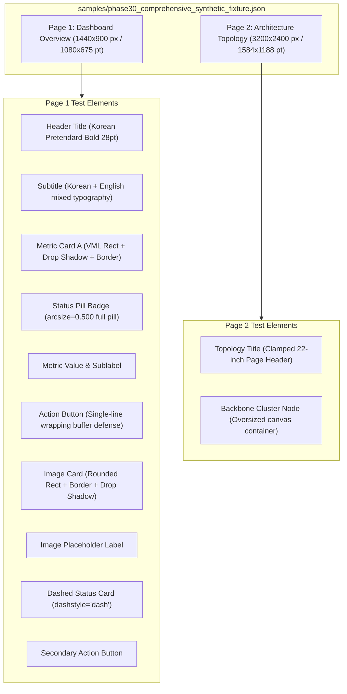

# 03. Synthetic Design Fixtures & Test Topologies

## 1. Fixture Strategy & Motivation

Visual regression testing in document conversion requires reproducible, deterministic fixtures that exercise complex edge cases without relying on fluctuating external third-party cloud assets.

In Phase 30, we authored `samples/phase30_comprehensive_synthetic_fixture.json`, a comprehensive multi-page Figma JSON fixture engineered to test the entire vector and typography spectrum.

### Fixture Cryptographic Provenance
- **Relative Path**: `samples/phase30_comprehensive_synthetic_fixture.json`
- **File Size**: 17,624 bytes (17.2 KB)
- **SHA-256 Digest**: `45a587e8ed5d7b9e76211c2ecdf07a1042d32d372a1505532d2f35c05c6160eb`
- **Generator Script**: `scripts/generate_phase30_synthetic_fixture.ts`

---

## 2. Structural Composition of the Fixture

The fixture defines 2 canonical canvas pages with 13 rich UI elements:

---

## 3. Detailed Component Test Matrix

| Component | Target Stress Feature | Expected OpenXML / VML / HWPX Output |
| :--- | :--- | :--- |
| **Header Title** | Korean text rendering without ascender clipping | `w:lineRule="atLeast"`, `w:line="380"` |
| **Subtitle** | Mixed CJK + Latin/Digits character spacing | `<w:autoSpaceDE w:val="0"/>`, `<w:autoSpaceDN w:val="0"/>` |
| **Metric Card A** | Drop shadow geometry and rounded corners | `<v:roundrect arcsize="0.053">` with `<v:shadow on="t" offset="0pt,3pt"/>` |
| **Status Pill Badge** | Symmetrical semicircular pill button | `arcsize="0.500"` (exact pill shape in Word) |
| **Action Button** | Single-line button label wrapping defense | `w:wordWrap w:val="0"`, `mso-wrap-style:none`, 4pt safety margin |
| **Image Card** | Rounded image clipping with border and shadow | `<v:roundrect arcsize="0.044">` enclosing `<v:imagedata>` + `<v:stroke>` + `<v:shadow>` |
| **Dashed Card** | Vector dashed stroke styling | `<v:stroke dashstyle="dash" weight="1.5pt"/>` |
| **Oversized Page 2** | Word 22-inch (1584 pt) maximum dimension limit | Uniform scale down from $3200 \times 2400\text{ px}$ to $1584 \times 1188\text{ pt}$ ($s = 0.495$) |

---

## 4. Parser & Topology Validation

When loaded into `FigmaCanvasParser`:
- Total pages parsed: 2
- Total Canvas IR elements: 13 (Page 1: 11 elements, Page 2: 2 elements)
- Scale preservation:
  - Page 1: $1440 \times 900\text{ px} \to 1080 \times 675\text{ pt}$ (Scale factor: $0.75\text{ pt/px}$, scale preserved: `true`).
  - Page 2: $3200 \times 2400\text{ px} \to 1584 \times 1188\text{ pt}$ (Scale factor: $0.495\text{ pt/px}$, clamped to Word 22" limit, scale preserved: `false`, structural defect flagged: `OVERSIZED_PAGE_CLAMPED`).

Verified by automated test in `tests/phase30-production-fidelity.test.ts` (Test 8).
