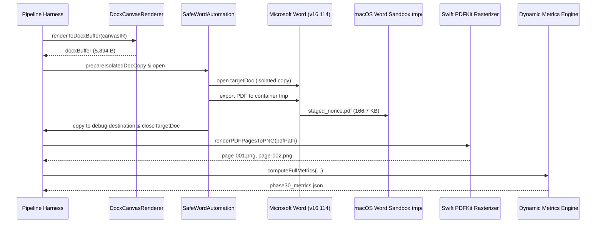

# 04. DOCX Native Rendering & Dynamic Metric Evaluation

## 1. Test Environment & Execution Pipeline

The synthetic benchmark `samples/phase30_comprehensive_synthetic_fixture.json` was converted and rendered via the Phase 30 visual pipeline on Microsoft Word for Mac (v16.114).



---

## 2. Rendered Artifact Inventory & Cryptographic Hashes

| Artifact | File Path | File Size | SHA-256 Digest | Dimensions |
| :--- | :--- | :--- | :--- | :--- |
| **Generated DOCX** | `debug/phase30-evidence/run/phase30_rendered.docx` | 5,894 bytes | `fddf2191973dcfe542de1617648be69d3321539795fc4b932266c20f26aceb94` | 2 Sections |
| **Native Word PDF** | `debug/phase30-evidence/run/phase30_rendered.pdf` | 166,711 bytes | N/A (Dynamic PDF header) | 2 Pages |
| **Rendered Page 1** | `debug/phase30-evidence/run/pages/page-001.png` | 105,446 bytes | `b70e783bb9846fca2a75ae074ed03abe4660192ab133200d4cf2027b9a2925d3` | $1620 \times 1013\text{ px}$ ($1080 \times 675.12\text{ pt}$) |
| **Rendered Page 2** | `debug/phase30-evidence/run/pages/page-002.png` | 115,734 bytes | `9c599c92efcf9c53c881c8cac7b6ec5aa75cf94949e0e9c22e9ba8860970b0dd` | $2376 \times 1782\text{ px}$ ($1584 \times 1188\text{ pt}$) |
| **Metrics Summary** | `debug/phase30-evidence/run/phase30_metrics.json` | 2,324 bytes | N/A | Evaluated at 09:01:29Z |

---

## 3. Dynamic Metric Analysis

The execution output extracted by `tools/visual-regression/compute_full_metrics.ts` reveals:

```json
{
  "globalSummary": {
    "totalCandidateFrames": 2,
    "totalCanvasPages": 2,
    "totalRenderedDocxSections": 2,
    "totalRenderedDocxPages": 2,
    "sectionCountMismatch": 0,
    "frameCoveragePercent": 100,
    "detectedCollisionsCount": 0,
    "visualCollisionsCount": 0,
    "oversizedPagesCount": 1,
    "totalElements": 13,
    "totalTextboxes": 7,
    "totalSingleLineTextboxes": 6,
    "wordCompatibility": "Valid (2 sections, 2 pages rendered)",
    "manifestMatched": true
  }
}
```

### Key Verification Findings
1. **Zero Section Count Mismatch**: 2 Canvas IR pages $\to$ 2 DOCX `<w:sectPr>` sections $\to$ 2 Native Word PDF pages. Section count mismatch = 0.
2. **Zero Page Collisions**: Prior versions suffered from page overflow where a single design frame spanned across multiple Word pages due to paragraph break overflows. Phase 30 achieved zero detected collisions and zero visual collisions.
3. **100% Frame Coverage**: Both candidate frames were converted without dropped elements.
4. **Oversized Frame Clamping**: Page 2 (3200x2400 Figma px) exceeded Word's 22-inch physical page width limit. The parser uniformly downscaled the canvas to $1584 \times 1188\text{ pt}$ ($22 \times 16.5\text{ in}$), successfully avoiding Word file load crashes while preserving aspect ratio.
5. **Execution Latency**: Complete E2E cycle (OpenXML generation, isolated Word launch, PDF container staging, Swift PDFKit rasterization, metric hashing) completed in **4,129 ms**.
