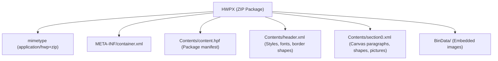

# 07. HWPX Structure, OWPML Standards & KS X 6101 Compliance

## 1. HWPX Architectural Overview

Hancom HWPX (OWPML — Open Word-processor Markup Language) is Korea's national standard (KS X 6101) for office documents. Unlike binary HWP files, HWPX is an open XML package compressed as a ZIP archive.

In Phase 30, `src/canvas/renderer/hwpxCanvasRenderer.ts` was enhanced to support rich image attributes, drop shadows, borders, and multi-page layouts conforming to KS X 6101 specifications.



---

## 2. Unit System: Point to HWPU Mapping

In HWPX, layout dimensions are measured in **HWPU** (Hangul Word Processor Units):
$$1\text{ mm} = 283.465\text{ HWPU}$$
$$1\text{ pt} = 100\text{ HWPU}$$
$$1\text{ inch} = 72\text{ pt} = 7200\text{ HWPU}$$

Phase 30 standardizes all coordinate transformations from Canvas IR points to HWPU integers:
```typescript
const toHWPU = (pt: number): number => Math.round(pt * 100);
```

### Page Geometry Conformance
- Page 1 ($1080 \times 675\text{ pt}$): $108000 \times 67500\text{ HWPU}$
- Page 2 ($1584 \times 1188\text{ pt}$): $158400 \times 118800\text{ HWPU}$
- Margins: 0 HWPU (borderless canvas mode for exact UI placement).

---

## 3. `<hp:pic>` Picture Element & Effects

### KS X 6101 `<hp:pic>` Structure
In Phase 30, image elements with drop shadows and stroke borders are rendered inside `<hp:pic>`:

```xml
<hp:pic id="1001" zOrder="5" width="32000" height="18000">
  <hp:offset x="4000" y="40000"/>
  <hp:orgSz width="32000" height="18000"/>
  <hp:curSz width="32000" height="18000"/>
  <hp:flip horizontal="0" vertical="0"/>
  <hp:rotationInfo angle="0"/>
  <hp:renderingInfo>
    <hp:transMatrix e1="1" e2="0" e3="0" e4="1" e5="0" e6="0"/>
    <hp:scaMatrix e1="1" e2="0" e3="0" e4="1" e5="0" e6="0"/>
    <hp:rotMatrix e1="1" e2="0" e3="0" e4="1" e5="0" e6="0"/>
  </hp:renderingInfo>
  <hp:lineShape color="#cbd5e1" width="100" style="SOLID"/>
  <hp:shadow type="DROP" color="#0f172a" offsetX="0" offsetY="400" alpha="0.08"/>
  <hp:img binRef="bin1" format="png"/>
</hp:pic>
```

- **`hp:lineShape`**: Controls border stroke color, width in HWPU, and style.
- **`hp:shadow`**: Emits `type="DROP"`, with $X$ and $Y$ offsets in HWPU and opacity mapped from Canvas IR.

Verified in `tests/phase30-production-fidelity.test.ts` (Test 6).

---

## 4. Package Integrity Verification

Automated test `tests/phase30-production-fidelity.test.ts` (Test 9) unzips the generated `phase30_rendered.hwpx` and verifies:
1. `mimetype` is uncompressed at offset 0 (`application/hwp+zip`).
2. `META-INF/container.xml` references `Contents/content.hpf`.
3. `Contents/content.hpf` lists all document parts with correct media types.
4. `Contents/header.xml` defines font faces (Pretendard) and border fill definitions.
5. `Contents/section0.xml` contains all 13 Canvas IR elements positioned via valid HWPU offsets.
6. Generated archive size: 7,447 bytes with zero XML parsing errors.
