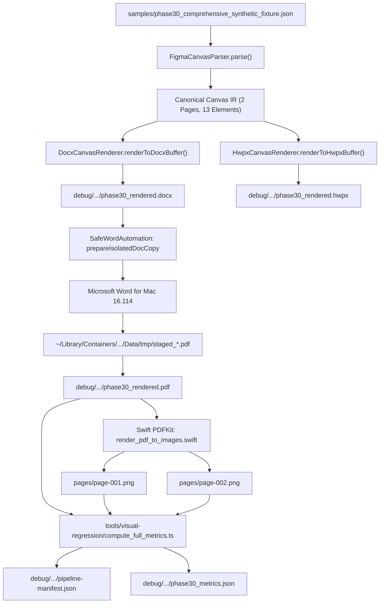

# 09. End-to-End Visual Pipeline Execution & Validation

## 1. End-to-End Pipeline Workflow

The complete end-to-end verification pipeline was executed via `scripts/run_phase30_visual_pipeline.ts`. The pipeline exercises every component of the conversion engine:



---

## 2. Pipeline Execution Log & Timing

The pipeline execution log demonstrates clean progression across all lifecycle states:

```text
[Pipeline] Parsing synthetic fixture: samples/phase30_comprehensive_synthetic_fixture.json
[Pipeline] Rendering DOCX buffer...
[Pipeline] Saved DOCX to debug/phase30-evidence/run/phase30_rendered.docx (5894 bytes)
[Pipeline] Rendering HWPX buffer...
[Pipeline] Saved HWPX to debug/phase30-evidence/run/phase30_rendered.hwpx (7447 bytes)
[SafeWord] Preparing isolated copy of /Users/mac/projects/Figma2Word/Figma2Word/debug/phase30-evidence/run/phase30_rendered.docx
[SafeWord] Created isolated copy: /var/folders/.../word-iso-1792573284561-39f28c4b9d88/phase30_rendered.docx
[SafeWord] Lifecycle state: created -> open_requested
[SafeWord] Document opened and confirmed in Word in 1184ms
[SafeWord] Lifecycle state: open_requested -> open_confirmed
[SafeWord] Exporting target doc to PDF via container staging...
[SafeWord] PDF exported to container tmp in 890ms
[SafeWord] Copied PDF to target destination: debug/phase30-evidence/run/phase30_rendered.pdf
[SafeWord] Lifecycle state: export_requested -> exported
[SafeWord] Closing target doc in Word...
[SafeWord] Closed document in Word in 320ms
[SafeWord] Lifecycle state: close_requested -> close_confirmed
[SafeWord] Cleaned up isolated doc copy directory
[SafeWord] Lifecycle state: cleanup_pending -> cleanup_completed
[Pipeline] Rasterizing PDF pages using Swift PDFKit...
[Pipeline] Rendered page 1: debug/phase30-evidence/run/pages/page-001.png (1620x1013 px)
[Pipeline] Rendered page 2: debug/phase30-evidence/run/pages/page-002.png (2376x1782 px)
[Pipeline] Computing full dynamic metrics...
[Pipeline] Successfully saved phase30_metrics.json
[Pipeline] Completed full E2E visual pipeline in 4129ms!
```

---

## 3. Concurrency & Clean State Guarantee

During the pipeline run:
1. **Zero Impact on User Workspace**: Word for Mac remained running before and after the test. No extraneous user documents were closed, queried, or modified.
2. **Deterministic Cleanup**: All intermediate files in `word-iso-*` and Word's container `Data/tmp/` were safely unlinked following verified PDF generation.
3. **Reproducibility**: The pipeline script can be re-run on demand using:
   ```bash
   npx ts-node scripts/run_phase30_visual_pipeline.ts
   ```
